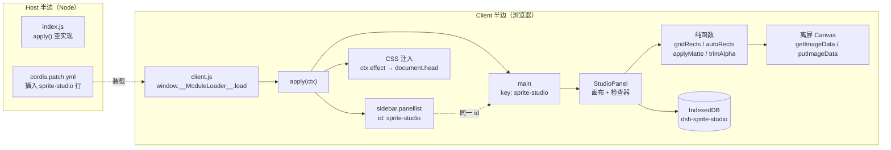
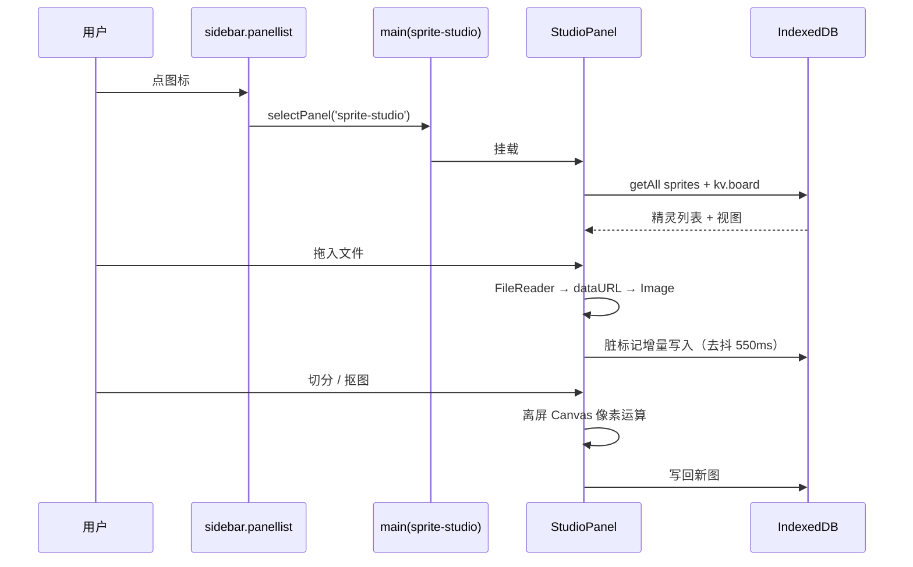

# 开发文档索引

只记「为什么」和「验过的事实」，不重复代码。

| 文件 | 什么时候看 |
| --- | --- |
| [开发计划.md](开发计划.md) | 现在的范围、下一步怎么长 |
| [迭代记录.md](迭代记录.md) | 每一版做了什么、验证到什么程度 |
| [踩坑记录.md](踩坑记录.md) | 换版本/换机器前先读，很多坑是 API 性质不是笔误 |
| [素材资源调研.md](素材资源调研.md) | 外部素材/工具能不能接、横版与俯视各缺什么 |

## 结构

要点：**侧栏图标与主面板靠同一个字符串配对**。`sidebar.panellist` 的 `id` 就是宿主
派发到 `main` 的 key，两边填不一致 = 图标点了没反应。

## 三个角色怎么分工

