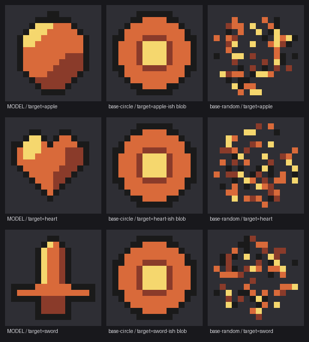

# 实验 01 · 文本模型能否「写」出可识别的像素图

日期：2026-11-09
问题：**能看图、不能生图的模型**（就是我），能不能用「输出色号网格」的方式画出可辨认的像素素材？能到什么程度？

---

## 假设

- H1：模型的直接输出（16×16 网格）比「无信息的程序化形状」更容易被认出它所声称的东西。
- H2（未在本轮测）：让模型看到自己的渲染结果再改一轮，会进一步提升。

## 设计

| 项 | 取值 | 为什么 |
| --- | --- | --- |
| 尺寸 | 16×16 | 「最简单」的下限；32×32 单帧约 1.2k token，先从小起点 |
| 色板 | 固定 5 色（0 透明 / 1 描边 / 2 暗 / 3 中 / 4 亮） | **把「配色」这个变量锁死**，只测形状 |
| 目标 | 苹果 / 剑 / 心形 | 三个都有强轮廓特征，但难度不同（心形 > 苹果 > 剑） |
| 条件 | ① 模型盲画 ② 程序化圆形 ③ 随机噪声 | ②③ 是**基准**：没有「画什么」的信息 |
| 判官 | 独立子智能体，**只看图**，从 12 个候选里强制选一个 | 强制选择才能量化，不能让它说「都不是」 |
| 候选 | 苹果/剑/心形/盾牌/药水/钥匙/蘑菇/星星/书/锤子/炸弹/羽毛 | 12 选 1，瞎猜命中率 8.3% |
| 盲法 | 渲染产物**重命名成 q1~q9**，判官看不到文件名 | 文件名里带答案，不重命名等于泄题 |



## 结果

| 条件 | 命中 | 判官的判断 |
| --- | --- | --- |
| 模型 · 苹果 | ✅ | 苹果（0.78）「奶油色月牙高光 + 顶部 2px 短梗」 |
| 模型 · 心形 | ✅ | 心形（0.96）「两个对称圆瓣、中间凹陷、下方收尖」 |
| 模型 · 剑 | ✅ | 剑（0.80）「细长剑身 + 横向护手 + 更短的握柄 + 剑首」 |
| 程序化圆 ×3 | ❌ 0/3 | 全部判成**盾牌**（0.42~0.45）——圆盘 + 中央凸饰确实像圆盾 |
| 随机噪声 ×3 | ❌ 0/3 | 心形 / 苹果 / 苹果（0.22~0.56）——被迫选一个时，噪声也能碰巧「像」点什么 |

**模型 3/3，基准 0/6。** 12 选 1 的瞎猜命中率是 8.3%，3/3 全中的概率约 0.06%。

## 观察

1. **判官真的在看图**：它们复述出了具体像素特征（「顶部 2px 黑色短梗」「左缘 F5D76E 浅黄高光」），
   不是靠提示词猜的。
2. **我自己判错了剑**：我先看渲染图，觉得「比例失调，像个十字架」。
   盲判的判官却准确认出「剑身 + 护手 + 握柄 + 剑首」的结构。
   → 作者对自己作品的判断并不可靠；**换一双没预期的眼睛**很重要。
3. **程序化圆稳定被判成盾牌**：这说明基准不是「随机垃圾」，
   而是一个**可解释但目标错误**的干扰项 —— 比纯噪声更有说服力的对照。
4. **随机噪声也能骗到人**：判官在没有真实答案时依然会给出「心形（0.56）」这种中等置信度。
   所以**必须**用强制选择 + 已知答案，否则「像」这个词没有意义。

## 局限（必须说清）

- **n=3**，太少了。3/3 只能说明「不是完全不可能」，不能给准确率。
- 判官和我同源（都是这个模型家族），存在**共同偏差**。
- 只测了 16×16 单帧、固定色板。真实素材是 32~64px、多帧、多方向。
- 没有测「迭代」——本轮是一次性输出。

## 下一步

1. **扩样本**：10 个目标 × 3 次重复，给出准确率与置信区间。
2. **加深难度**：32×32；易混对（剑/匕首/十字架、苹果/橘子/番茄、心形/盾牌）。
3. **测迭代**：给模型看自己的渲染图，允许改 2 轮 —— 这才是「能看图」的真正价值，
   也是和纯文本模型的分水岭。
4. **测跨帧一致性**：同一角色 4 帧行走，看会不会变形（预期会失败，但要数据）。

## 复现方式

```
render.py  输入 [{id, rows}] → PNG + 客观指标（填充率/唯一色数/连通域/对称性）
build.mjs  生成模型网格与两个基准
判官      独立子智能体，read_image 后强制 12 选 1
```

客观指标（本轮）：

| 样本 | 填充率 | 连通域 | 对称性 |
| --- | --- | --- | --- |
| 模型 苹果/剑/心 | 0.39~0.49 | **1** | 1.00 / 1.00 / 0.75 |
| 随机噪声 | 0.25 | **14~22** | ~0.28 |
| 程序化圆 | 0.61 | 1 | 1.00 |

→ **连通域数量是最便宜的自动质检**：模型产出的图是整块，随机噪声是碎的。
这条可以直接做成插件里的「碎点检测」，不用人看。
