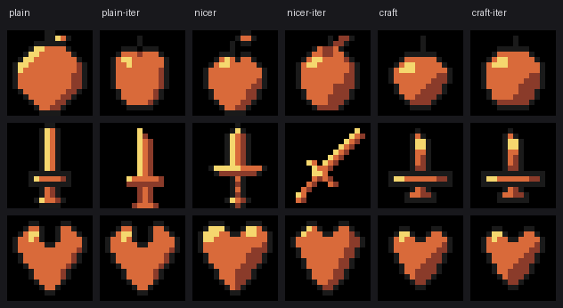

# 实验 02 · 2×3 因子设计：提示词 × 视觉迭代

日期：2026-11-09 · 承接 [实验 01](实验-像素网格-01.md)

## 问题

- H1：**精心写的技法提示词**能让 16×16 图标更像「像素画」（而不是缩小插画）？
- H2：**让模型看自己的渲染再改几轮**，能提升质量？

## 设计

2×3 因子，每格 3 个目标（苹果 / 剑 / 心形），共 **18 个格子**。

| 因子 | 水平 |
| --- | --- |
| 提示词 | `plain` 只说画什么 · `nicer` 加一句「画好一点、精致一点」 · `craft` 精心写法（下表） |
| 迭代 | 无 · 有（子智能体自己渲染、`read_image` 看、改，至少 3 版） |

`craft` 提示词的依据（[saint11 抗锯齿与 banding](https://saint11.art/pixel_art_articles/article5/) 等像素画通识）：

1. 先定轮廓：缩到 8×8 还认得出
2. 外轮廓闭合、**1 像素**深色描边，不断口
3. 只用 2~3 个明度层次，光源统一左上，高光是 3~6 像素的小块而不是沿边一条
4. 斜线用 1×1 阶梯，禁止 2×2 大台阶（jaggies）
5. **不做抗锯齿**（16×16 上会糊）
6. 无孤立单像素、无 1 像素毛刺
7. 避免 banding：相邻色阶不要平行铺成条纹，让色块成团
8. 四周留 1 格透明，主体居中
9. 附自检清单

## 结果

**① 识别率：封顶，无法区分**

16 张被盲判（12 选 1，另 2 张判官未返回）：**16/16 全对**。
所有条件都能被认出来——*16×16 + 三个区分度高的物体，这个任务太容易了*。

**② 技法质量分（1–5 × 4 项，独立判官）**

| 条件 | 轮廓 | 明暗 | 像素干净 | 可辨识 | 总分 /20 |
| --- | --- | --- | --- | --- | --- |
| plain | 4.00 | 4.00 | 4.33 | 4.67 | **17.00** |
| plain + 迭代 | 3.67 | 3.67 | 4.67 | 5.00 | **17.00** |
| nicer | 3.67 | 4.00 | 4.33 | 4.33 | **16.33** |
| nicer + 迭代 | 3.33 | 4.00 | 4.00 | 4.00 | **15.33** |
| craft | 4.67 | 4.33 | 4.67 | 4.00 | **17.67** |
| craft + 迭代 | **4.67** | **4.67** | **5.00** | 4.00 | **18.33** |

**③ 客观指标：描边覆盖率（轮廓像素里深色描边的比例）**

| 条件 | 三个目标 | 均值 |
| --- | --- | --- |
| plain | 95% / 100% / 94% | 96.3% |
| plain + 迭代 | 97% / **0%** / 100% | 65.7% |
| nicer | 100% / 78% / 100% | 92.7% |
| nicer + 迭代 | 76% / **0%** / 100% | 58.7% |
| craft | 100% / 100% / 100% | **100%** |
| craft + 迭代 | 100% / 100% / 100% | **100%** |

孤立像素：**18 张全是 0**（16×16 上大家都画成整块，这个指标在这里没有区分度）。

## 结论

**1. 提示词有效，而且效果可测量。**
`craft` 组是唯一在「有迭代 / 无迭代」两种情况下描边覆盖率都 100% 的，
质量分也最高（17.67 / 18.33 vs 17.0 / 16.33）。它真的在改变画法，不只是改变说法。

**2. 迭代本身不提升，甚至会毁掉已有的规范。**
边际均值：无迭代 **17.0**，有迭代 **16.9** —— 几乎没有差别。
最刺眼的是两张剑：`plain+迭代` 和 `nicer+迭代` 的描边覆盖率掉到 **0%**，
画成了一条没有轮廓的细斜线（见第二行第四列）。

**3. 迭代会放大提示词里说的东西——说什么就优化什么。**
- `nicer` 只说了「好看」，迭代去优化「像不像」，结果**丢掉了技法**（17.0 → 15.33）
- `craft` 明确给了技法标准，迭代才有东西可以对（17.67 → **18.33**）

> 换句话说：**迭代不是"自动变好"，是"自动变成你要求的样子"。要求模糊时，它会漂。**

## 方法上的教训

- **第一轮实验废了**：workflow 只返回了 `ok: true`，18 份网格全丢。第二轮改成「agent 自己把结果写进文件」，
  数据不进上下文，也更可靠。**跑批量 agent 前先想清楚产物落在哪。**
- 子智能体的中间稿把工作目录塞满（114 个文件里只有 18 个是正式产物），收集时按固定 id 白名单取，不能扫目录。
- 质量分是**单判官单次**打的，没有重复、没有一致性检验。

## 局限

- 每格 **n=3**，无法做显著性；这里的结论只能当**方向**。
- 识别率封顶说明任务太简单，下一轮必须换更难的题（近似物体、更细的差别）。
- 判官与作者同源（同一个模型家族），存在共同偏差。
- 只测 16×16、单帧、固定色板。

## 下一步

1. **换难题**：候选里放近似项（苹果/橘子/番茄、剑/匕首/十字架），或直接把 12 选 1 换成「两图对比哪个更好」。
2. **加重复**：每格 5 次，报均值与离散度。
3. **迭代加「目标函数」**：把 4 项技法分数做成自动检查回喂给迭代的 agent，
   验证「有明确目标的迭代是否真的有用」——这是本实验最值得追的一条。
4. **32×32**（PixelBench 的甜点分辨率），看结论是否仍然成立。
