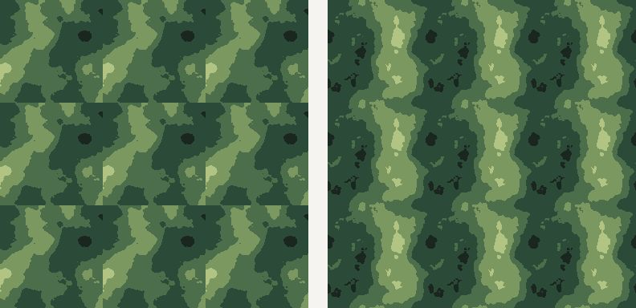

# 素材与工具资源调研

调研时间 2026-11-06。目的：判断四份外部资源哪些能接进「切片牢大」，以及横版 / 俯视两条线各自缺什么。

> 判断标准不是「资源好不好」，而是**它吐出的东西，是不是本工具能吃进去、或者能立刻加工的东西**。
> 插件现在是「位图进 → 位图出」：导入 → 切分 → 抠图 → 打包导出。

## 一句话结论

| 资源 | 是什么（已核实） | 对插件 | 横版 | 俯视 |
| --- | --- | --- | --- | --- |
| [Universal LPC Spritesheet Character Generator](https://liberatedpixelcup.github.io/Universal-LPC-Spritesheet-Character-Generator/) | 拼装 LPC 角色图的 Web 应用，输出整张 spritesheet + 授权清单 | **最适合**：产出物正是本工具的输入 | 弱 | **强** |
| [NoiseGen](https://bbccx021.github.io/NoiseGenerator/) | 浏览器里的无缝湍流贴图生成器，导出 PNG / 批量 ZIP | **值得**：补上「生成」这一环 | **强** | **强** |
| [Pixel Engine](https://pixelengine.ai/guides/connect) | AI 像素画生成服务，对外是 MCP server（OAuth，按 credits 计费） | **值得**，但走 Agent 侧 MCP，不做进插件 UI | **强** | **强** |
| [Pixel Water（Godot shader）](https://fcidade.itch.io/pixel-water-godot-shader-free) | Godot 4 的 CanvasItem 着色器，不依赖贴图，CC0 | **不能直接整合**：它不是位图 | 中 | 中 |

## 逐个说清楚

### 1. LPC Generator —— 唯一「产出即输入」的资源

**能力**（读的是仓库 README）：把 LPC 系列角色素材按层拼成一张 spritesheet，
附带一份 `CREDITS.csv`（列出每个用到的素材的作者、许可、原始链接）；
支持导出 JSON 以便下次接着改；有 Godot 3.5 / 4.2 插件与 RPG Maker MZ starter kit。

**为什么最适合**：
- 它输出的就是**一张 sprite sheet**，这正好是本插件的主场（切分 + 抠图 + 打包）。
- 它是**3/4 俯视、64×64 基准**的角色图（README 明确提到 "stuck to a standard 64x64 format"），
  按「动作 × 方向」组织，天然适配俯视 RPG / 肉鸽。

**怎么接（关键：只预置参数，不分发素材）**：
- 在「切图」面板加一组 **LPC 预设**：选动作（walk / slash / thrust / spellcast / shoot / hurt，以及 LPCE 的 bow / climb / run / jump），
  自动填行列、每帧尺寸，并按 `walk_down_01` 这种规则命名帧。
- **帧数、方向数、行列布局必须可以在界面上改**——生成器自己也会随 ElizaWy 的修订改动帧序，
  硬编码就会随版本漂移。预设只做「少填几个输入框」。
- 不做「内嵌生成器」：它是 Vite 应用，跨域 iframe 既拿不到数据也难看。

**许可（重要）**：素材是 CC0 / CC-BY-SA / CC-BY / OGA-BY / GPL 混合，
**多数要求署名**，CC-BY-SA 还带传染；生成物用于游戏可以，但要在游戏里能被找到地列出 credits。
→ 所以插件**只存网格参数、不打包任何 LPC 图片**，许可风险为零；用户自己下载的图，署名责任在他。

**横版为什么弱**：LPC 是 3/4 俯视透视，左右朝向那一列仍是 3/4，直接拿去做纯横版平台跳跃会「歪」，不是真侧视。

### 2. NoiseGen —— 补「生成」这一环

**能力**（读的是页面）：无缝（seamless）湍流贴图；多种贴图类型与特效预设；分辨率、随机种子、
细节层数、缩放、拉伸比（1:1 / 2:1 / 4:1 / 8:1 等）；第二层噪波与 9 种混合模式
（相乘/相加/最大/最小/滤色/覆盖/柔光/差值/相减）；**通道打包 RGBA**；后处理（反相/自动色阶/对比/Gamma/黑白点/亮度）；
**平铺预览 + UV 滚动预览**；导出 PNG、批量 ZIP、分享链接。

**为什么值得**：
- 横版视差背景、俯视地面/水面/雾，本质上都是**无缝平铺贴图**，插件现在一张都造不出来。
- 它输出的也是 PNG，落进画布后能继续用现有的抠图/切分/打包。

**怎么接**：**自研一个精简版**，不做 iframe、不做链接跳转。
- v1：单层 fBm 噪声（周期化保证无缝）+ 双色映射 + 分辨率/种子 + **平铺与滚动预览**。
- 通道打包、双图层混合、9 种混合模式留到之后（那是另一个产品的复杂度）。
- 算法本身无版权问题；**别照搬它的 UI**。

### 3. Pixel Engine —— 好，但走 MCP 而不是插件 UI

**能力**（读的是 connect 指南）：对外是一个 **MCP server**（`https://api.pixelengine.ai/functions/v1/mcp`），
OAuth 登录、不需要 API key、按 credits 计费。它能让 Agent 做：按描述生成像素角色/道具/地块、
把精灵做成循环动画或 sprite sheet、把已有图转成像素画、**给动画去背景**、查余额。
文档里还写了「角色四周要留出挥砍/跳跃的空间」「哪种帧数适合哪种动作」「成品背景要纯色更好处理」这类经验。

**为什么值得**：它是本插件唯一能补上「素材从哪来」的外部能力，且输出天然是 sheet；
横版（side view 角色/地块）和俯视（top-down tiles）都能覆盖，取决于提示词。

**怎么接（两种深度）**：
- **浅（推荐先做）**：接成 DSH 的 MCP 连接器，让 Agent 生成 → 落到工作区 → 用户拖进画布。
  插件代码零改动，密钥/授权都由连接器系统管。
- **深（要拍板）**：插件 UI 里放「AI 生成」按钮。这要求插件自己持有 API key 或走 OAuth，
  并且**每次点击都在花用户的钱**。属于必须用户拍板的取舍，不该默认打开。

### 4. Pixel Water —— 代码不能整合，借它的一个概念

**能力**（读的是 Godot Asset Store 页面）：Godot 4 的 CanvasItem 着色器，**不含任何贴图**，
程序化画像素水面（三档蓝、浪尖、岛屿沙滩、浅水、泡沫、云影、微光），
4 套配色预设 + 9 个颜色参数，**默认速度下每 8 秒精确循环**，许可 **CC0**，体积 11.34 KB。

**为什么不能整合**：它是**运行时着色器**，产出不是位图；本插件是静态图工作台。
硬搬过来要么引一个 WebGL 管线，要么把 GDScript 逻辑重写一遍——都不划算。

**能借的一层**：它「精确循环的视频/GIF」这个定位，对应到精灵工具的刚需是
**「这段背景是不是无缝、循环起来会不会跳」**。所以值得做的是**平铺 + 滚动预览**
（选中一张背景条，按 0.5× 速度横向循环滚动），成本很低，对横版价值很高。

## 横版 / 俯视：两条线各自缺什么

| 需求 | 横版（side-scroller） | 俯视（top-down） | 现有能力 |
| --- | --- | --- | --- |
| 角色多帧 | 侧面行走/跳跃/攻击 | 四向行走/攻击 | 切分 ✅ |
| 素材来源 | 需要纯侧视像素角色 | **LPC 可直接用** | ❌ |
| 背景 | 视差层 + 无缝平铺 | 地表/水面平铺 | ❌ **最大缺口** |
| 元数据 | atlas + 帧序 + 锚点 | 同上 | 半有（manifest 只有尺寸/坐标） |
| 验证 | 平铺滚动是否接缝 | 四向对齐、脚底对齐 | ❌ |

结论：**素材不是主要瓶颈，「背景生成 + 元数据 + 预览」才是。**

## 建议的整合顺序（四批调研后的最终版）

| 顺位 | 做什么 | 补哪个短板 | 依据 | 成本 |
| --- | --- | --- | --- | --- |
| 1 | **无缝材质生成 + 平铺/滚动预览** | 造背景 · 无缝验收 | simplex-noise（MIT，4D 环面采样）+ RgbQuant（MIT，9 种抖动核）+ 3×3 重复预览 | 低 |
| 2 | **网格预设**（LPC 64×64 / Kenney 18×18 / 16×16 / LPC Atlas 32×32） | 一键切对 | 全是 `CC0` 或「只预置参数不内置图」，许可干净 | 低 |
| 3 | **图集打包 + pivot 元数据** | 图集 · 锚点 | maxrects-packer（MIT）+ 照抄 Aseprite 的 `frame/pivot/spriteSourceSize` 字段 | 中 |
| 4 | **AI 生成走 MCP 连接器** | 素材从哪来 | Pixel Engine（OAuth 零 key、100 credits/月免费）｜Retro Diffusion（$0.03/张，输出归你） | 零插件改动 |
| 5 | **动画预览**（onion skin 最小版） | 帧序验真 | 照 Pixelorama 的 frame tag + onion skin 结构 | 中 |
| — | **Pixel Water：不做** | — | 运行时着色器，产出不是位图 | — |

**横版保底**：Kenney Pixel Platformer（18×18 预设）+ ansimuz CC0 视差（内容源）+ 第 1 条无缝背景生成。
**俯视保底**：Kenney Roguelike 16×16 + LPC 64×64（预设）+ Ninja Adventure（内容源，四向动画）。

## 不做什么，以及为什么

- **不内嵌 LPC 生成器**：跨域 iframe 拿不到数据，体积和许可都不可控。
- **不打包有署名/传染义务的素材**：LPC 系（CC-BY-SA + GPL）、Metroidvania（SA/GPL）、CraftPix（禁再分发）、
  Cainos（禁再分发）、Sprout Lands 免费版（仅非商用）—— 这些一律只能 `内容源`。
- **不在插件里内置 API key**：Retro Diffusion 的 ToS 明写「不要把 key 放进别人能读到的客户端代码」，
  PixelLab 对「自建服务/转售」要求先联系。内置 key 不是「便宜」而是「埋雷」→ 走 MCP 让用户用自己的账号。
- **不接 remove.bg**：官方公告 2026-12-01 起背景移除迁到 Leonardo.Ai，只剩三周；且免费额度仅限非商用。
- **不搬 Godot shader**：产出形态不同，重写成本远大于收益。


---

# 资源库（分批收录）

规则：**每条都要子代理实际打开页面核实**；页面没写许可就标「未核实」，不补猜。
「整合方式」分五档：`内容源`（用户下载后拖进来，插件不改）/ `内置预设`（插件预置网格参数）/
`生成器`（做成插件内功能）/ `只读指引`（只留链接与说明）/ `不合适`。

## 批次一 · 横版 / side-scroller（12 条）

| # | 资源 | 给什么 | 许可 | 整合方式 | 横版 | 俯视 |
| --- | --- | --- | --- | --- | --- | --- |
| 1 | [Kenney Pixel Platformer](https://kenney.nl/assets/pixel-platformer) | 整包 200 文件，**Tile 18×18**，含角色/地形/道具 | **CC0** | **内置预设**（18×18 硬网格） | 强 | 弱 |
| 2 | [Kenney Pixel Platformer Blocks](https://kenney.nl/assets/pixel-platformer-blocks) | 80 文件纯地形块，同 18×18 | **CC0** | 内置预设 | 强 | 弱 |
| 3 | [ansimuz SunnyLand](https://ansimuz.itch.io/sunny-land-pixel-game-art) | 横版 all-in-one：角色/敌人/机关/VFX/音乐，另有 Individual Spritesheets | **CC0** | 内容源 | 强 | 弱 |
| 4 | [Pixel Frog Pixel Adventure](https://pixelfrog-assets.itch.io/pixel-adventure-1) | 全图像 PNG，标注 20 FPS / 50 ms | **CC0**（明写免署名） | 内容源 | 强 | 弱 |
| 5 | [Cainos Village Props](https://cainos.itch.io/pixel-art-platformer-village-props) | **32×32**：124 props + 草地 tileset + 宝箱动画 | 可商用、免署名，但**禁止再分发** | 内容源（**不可内置**） | 强 | 中 |
| 6 | [Admurin Parallax Backgrounds](https://opengameart.org/content/parallax-backgrounds) | 5 主题分层视差，**384×216**，5–8 层 | CC-BY 4.0（**必须署名**） | 内容源 + 只读指引 | 强 | 弱 |
| 7 | [MatiasVME Forest Parallax](https://opengameart.org/content/parallax-background-forest-pixel-art) | 独立图层 + `.aseprite` 源文件 | **CC0** | 内容源 | 强 | 弱 |
| 8 | [ansimuz Forest Background](https://opengameart.org/content/forest-background) | 分层 + 可无缝循环 + PSD | **CC0** | 内容源 | 强 | 弱 |
| 9 | [ansimuz Mountain at Dusk](https://opengameart.org/content/mountain-at-dusk-background) | 分层无缝视差，下载 63k、收藏 372（本批最高） | **CC0** | 内容源 | 强 | 弱 |
| 10 | [ansimuz Industrial Parallax](https://opengameart.org/content/industrial-parallax-background) | 完整 looped / layered / seamless | **CC0** | 内容源 | 强 | 弱 |
| 11 | [PauR Nature tileset](https://opengameart.org/content/nature-tileset) | **32×32** 单张示例（完整版在 Unity 商店售） | CC-BY 3.0（署名 Paulina Riva） | 内置预设 + 只读指引 | 强 | 弱 |
| 12 | [Chloe Wolfe Metroidvania v2](https://opengameart.org/content/metroidvania-tileset-v2) | 单张城堡/洞穴 tileset | CC-BY 3.0 + **CC-BY-SA** + GPL（多许可并列） | 只读指引 | 强 | 弱 |

**这一批的结论**：

- 唯一同时满足「CC0 零署名负担 + 页面明标硬网格 + 覆盖角色/地形/道具」的是 **Kenney Pixel Platformer（18×18）**，
  它是 `内置预设` 的模板案例：接起来只需要一组行列参数。
- **ansimuz 的 CC0 视差三件套**（Mountain at Dusk / Forest / Industrial）是这批里唯一
  「不要署名 + 明写 separated layers + seamlessly looped」的，正好吃到插件现有流程
  （多层 PNG 拖入 → alpha 连通域切层 → ZIP 打包），**插件一行不用改**。
- 视差先接 **Mountain at Dusk**：CC0 无署名义务、明确 looped/seamless、社区验证度最高。
  Admurin 内容更多（5 主题、5–8 层）且是唯一标了精确 384×216 的，但 CC-BY 强制署名，
  接进去要先在插件里做 attribution 位，放第二批。

**这一批暴露的缺口（重要）**：

- **2:1 / 4:1 长条视差一条都没拿到精确尺寸**。12 条里只有 Admurin 标了 384×216（16:9，不是 2:1），
  其余只写 "looped / seamless"。→ 插件**无法**为它们预置条带宽高，只能拖入后自适应。
  这不是漏查，是上游就没给。
- 抓取失败并如实跳过的：`ansimuz.com` 作品页 404、`vnitti.itch.io/parallax` 404、
  OGA 的 `free-platformer-tileset-16x16` 404；SunnyLand 首次 fetch 失败、重试成功（用了成功那次的内容）。
- Kenney 的 `background-elements-redux` 301 到 `remastered`，是**矢量风**不是像素 → 已剔除。
- **「可商用」≠「可打包进插件」**：Cainos 明禁再分发；Metroidvania 带 SA/GPL 传染。
  这类素材只能走 `内容源` / `只读指引`，进不了 `内置预设`。这条规则要写进筛选逻辑。

## 批次二 · 俯视 / top-down（12 条）

| # | 资源 | 给什么 | 许可 | 整合方式 | 横版 | 俯视 |
| --- | --- | --- | --- | --- | --- | --- |
| 1 | [Kenney Roguelike/RPG Pack](https://kenney.nl/assets/roguelike-rpg-pack) | 俯视地块/物件/UI，**16×16**，Files 1700× | **CC0** | **内置预设**（16×16 网格） | 弱 | 强 |
| 2 | [Kenney Tiny Town](https://kenney.nl/assets/tiny-town) | 小镇/overworld 地块，**16×16**，130 文件 | **CC0** | 内置预设 | 弱 | 强 |
| 3 | [0x72 DungeonTileset II](https://0x72.itch.io/dungeontileset-ii) | 地牢 tileset + 角色，**整包仅 406 kB** | **CC0**（作者：Credit is not necessary） | 内置预设（地块）/ 内容源（角色） | 弱 | 强 |
| 4 | [Ninja Adventure Asset Pack](https://pixel-boy.itch.io/ninja-adventure-asset-pack) | 16×16：50+ 角色（**四向动画**）+ 30+ 怪物 + 9 Boss + 60+ 道具 + tileset + 音频/UI | **CC0**（免署名） | 内容源 + tileset 可做预设 | 弱 | 强 |
| 5 | [CraftPix 四向女性基础角色](https://craftpix.net/freebies/free-base-4-direction-female-character-pixel-art/) | 四向 + 十余组动作（走/跑/边跑边攻/受伤/死亡），PNG + PSD | CraftPix 免费品：可商用、**免署名**、**禁再分发源文件** | 内容源（不可内置） | 中 | 强 |
| 6 | [CraftPix Island Adventure Kit](https://craftpix.net/freebies/free-island-adventure-pixel-top-down-minigame-kit/) | 模块化岛屿 tileset + 2 角色 + 7 生物 + 整套 UI，**每帧独立文件** | 同 #5（免署名、禁再分发） | 内容源 | 弱 | 强 |
| 7 | [OGA LPC Tile Atlas](https://opengameart.org/content/lpc-tile-atlas) | **1024×1024 单张图集**，按 **32×32** 打包 | CC-BY-SA 3.0 + GPL 3.0（**必须署名**、SA 传染） | 内置预设（网格）/ **不内置美术** | 弱 | 强 |
| 8 | [OGA LPC Character Bases](https://opengameart.org/content/lpc-character-bases) | 6 体型模块化角色基础体 + 可换头，walk/run/slash/cast… | CC-BY-SA 3.0 + GPL 3.0（必须署名） | 内置预设（64×64）+ 内容源 | 中 | 强 |
| 9 | [Universal LPC Generator](https://liberatedpixelcup.github.io/Universal-LPC-Spritesheet-Character-Generator/) | 网页拼装 → **导出整张 LPC sheet** + Credits(text/CSV) + JSON 存配置 | 逐资源混合（CC0/CC-BY-SA/CC-BY/OGA-BY/GPL） | **生成器** + 内置预设（64×64） | 中 | 强 |
| 10 | [Sprout Lands](https://cupnooble.itch.io/sprout-lands-asset-pack) | 农场/岛屿俯视素材，Basic 包 299 kB 免费 | **免费版仅限非商用**；付费版（≥$3.99）可商用；两档**都要署名** | 内容源（**免费版不可内置**） | 弱 | 强 |
| 11 | [LimeZu Modern Interiors](https://limezu.itch.io/moderninteriors) | 俯视**室内**巨型 tileset，16×16，付费版附角色生成器 | 付费版：可商用、**须署名**、禁转售；**免费版许可未核实**（说明页 429/404） | 内容源 + 只读指引 | 弱 | 强 |
| 12 | [Sprite Fusion](https://www.spritefusion.com/) | 免费 Web tilemap 编辑器，导出 **单张 map.png** / JSON / TMX | 工具免费（无需登录，商用可，导出上限 4.5MB） | 只读指引 | 中 | 强 |

**这一批的结论**：

- **Kenney Roguelike/RPG Pack 是俯视版的「Kenney Pixel Platformer」**：CC0 + 16×16 硬网格 + 1700 文件，
  零许可风险，直接当 `内置预设` 样板。
- **0x72 DungeonTileset II 整包 406 kB**，CC0 —— 体量小到「随插件附带示例素材」在技术上完全可行
  （要不要附带是产品决定，不是许可问题）。
- **Universal LPC Generator 仍是唯一「拼装即出整张 sheet」的生成器**，且 LPC 固定 64×64 单帧
  （官方 README 写明 "stuck to a standard 64x64 format"），预设行列有据可依。
- **LPC Tile Atlas 是新增的硬网格样本**：1024×1024 按 32×32 打包，等于 32 列，
  是最容易「一键切对」的图集之一（但它 CC-BY-SA，只能预置参数、不能内置图）。

**这一批的坑（下游必须知道）**：

- **Sprout Lands 免费版只能非商用**。若插件把免费包当示例素材内置，用户拿去商用就踩雷 ——
  这类「免费版 ≠ 可商用」的资源必须走 `内容源`，且界面上要提示。
- **LimeZu 免费版许可查不到**（devlog 返回 429/404）。**不猜**，标「未核实」；
  对应地它的免费包也不能进预设。
- **0x72 的角色帧不是严格 16×16**：评论区有用户反馈「按 16×16 导入时角色被切成两半」。
  这是**用户评论不是作者声明**，但足以说明「地块 16×16」不代表「角色也 16×16」——
  **地块预设和角色切分必须分开处理**，角色走 alpha 连通域更稳。
- **CraftPix 的「需不需要署名」与「能不能再分发」是两件事**：它免署名，但 2.2.1 明禁再分发源文件 →
  仍只能 `内容源`。**署名负担轻 ≠ 可以内置**，这和第一批的 Cainos 是同一类陷阱。

## 批次三 · 工具与算法（12 条，对应插件五个短板）

> 短板编号：**①** 造不出无缝平铺背景 · **②** 没有图集打包 · **③** 没有动画预览 ·
> **④** 没有锚点/帧命名 · **⑤** 没有像素级编辑（**不打算做**）

| # | 工具 | 形态 / 许可 | 补哪个 | 怎么用 | 成本 |
| --- | --- | --- | --- | --- | --- |
| 1 | [TextureGenerator-Online](https://cpetry.github.io/TextureGenerator-Online/) | 在线（纯前端 canvas）/ **MIT** | ① | 内嵌实现 | 低 |
| 2 | [simplex-noise.js](https://github.com/jwagner/simplex-noise.js) | JS 库 / **MIT**，~2KB | ① | 内嵌实现 | 低 |
| 3 | [free-tex-packer](https://github.com/odrick/free-tex-packer) | 桌面 + CLI / **MIT** | ② | 只借 schema | 中 |
| 4 | [maxrects-packer](https://github.com/soimy/maxrects-packer) | npm 库 / **MIT** | ② | 内嵌实现 | 低 |
| 5 | [Aseprite sprite sheet / slice 文档](https://www.aseprite.org/docs/sprite-sheet/) | 商业软件 / **专有 EULA** | ③④ | 只借 schema | 低 |
| 6 | [Pixelorama](https://pixelorama.org/) | Godot 桌面 + Web / **MIT** | ①③④ | 只借思路 | 高 |
| 7 | [Piskel](https://www.piskelapp.com/) | 浏览器在线 / **Apache-2.0** | ②③ | 读实现 | 中 |
| 8 | [LibreSprite](https://libresprite.github.io/) | 桌面 / **GPL-2.0** | ①③ | 只借思路（代码不可用） | 高 |
| 9 | [Lospec](https://lospec.com/palette-list) | 在线库 / **单板许可未核实** | ① | 预置参数 | 低 |
| 10 | [Ditherpunk](https://surma.dev/things/ditherpunk/) | 算法文章 + JS / **未核实** | ① | 只借思路 | 低 |
| 11 | [RgbQuant.js](https://github.com/leeoniya/RgbQuant.js) | JS 库 / **MIT** | ① | 内嵌实现 | 低 |
| 12 | [Character Studio](https://opengameart.org/content/character-studio-%E2%80%94-pixel-art-editor) | 在线单页 / **CC0** | ①③④ | 读实现 + 抄交互 | 低 |

### 两条最该先铺的线

**A. 无缝材质（补 ①，当天可出效果）**

```
simplex-noise 4D 噪声 → 环面(torus)采样 → 双色映射
      → RgbQuant 调色板量化 + 误差扩散抖动
      → 3×3 重复预览验收（本质就是 9 次 drawImage）
```

- **4D 噪声做环面采样**是数学上可平铺的最短路径：把 (x,y) 映射到四维环面上的两个圆，
  回到 2D 就天然无缝。库本身**不提供** tileable 封装，要自己写 20–40 行。
- **无缝必须自己做**：`TextureGenerator-Online` 虽然 MIT 又纯前端，但**它没有平铺/无缝开关**
  （逐项看过 UI），只能抄它的材质类型与参数面板。
- 抖动别自己发明：RgbQuant 自带 9 种误差扩散核（Floyd–Steinberg / Stucki / Atkinson / Jarvis / Burkes / Sierra…），
  `palette` 可直接喂 Lospec 的 `.gpl` / `.hex`。



上图是用这套算法原型直接生成的对比（128×128 各铺 3×3）：
左边晶格不环绕，每条平铺边界都断开；右边晶格索引取模，跨边界连续。
**注意右图仍看得出是同一块在重复** —— 无缝只解决"接缝"，不解决"重复感"；
真实项目要靠更大尺寸 / 更多细节层 / 叠一层不同周期的噪声来掩盖。

**B. 图集打包（补 ②，顺带补 ④）**

- `maxrects-packer`：MaxRects 装箱，`pot`（补到 2 的幂）、`border`、`allowRotation`、`smart` 都有，
  `addArray()` 直接把 `x/y/rot` 写回对象数组。**它只算矩形，不画图也不出 JSON** —— 合成与元数据要自己补。
- 元数据字段**照抄 Aseprite 的**（`frame` / `pivot` / `spriteSourceSize` / `sourceSize` / `slices.center`）——
  这是事实标准，引擎侧普遍能认；`free-tex-packer` 的 mustache 模板是同样字段的现成答案。
- 这条同时解决 ④：**pivot（锚点）进了 manifest，脚底对齐才有依据**；没有 pivot 的图集，引擎里还得手算。

### 这一批的坑

- **`free-tex-packer` 的在线版已经没了**：`free-tex-packer.com/app` 302 到疑似域名停放的地址，打不开；
  README 首行也写明作者已基本停更（只修 critical bug）。**只抄 JSON schema，不要依赖它的工具**。
- **Aseprite 是专有 EULA**（Igara Studio）：源码只允许个人编译或向项目贡献，禁止分发与反向工程。
  **一行代码都不能并**，只能读文档抄字段语义。
- **LibreSprite 是 GPL-2.0**：与闭源插件不兼容，只能用眼睛看它的 **Tiled drawing mode**
  （边画边实时平铺，正是做无缝地表时的编辑体验参考）。
- **Pixelorama 是 MIT 不是 GPL**：它从 Aseprite 的 GPL 血脉分出来后换了协议，以仓库 license 字段为准。
  → 这条纠正值得记：**许可证要看仓库字段，不要凭「fork 自谁」推断**。
- **Lospec 的单个调色板没有任何许可标注**：站点工具免费，但配色本身能否随插件分发**未核实**。
  → 只做「用户导入 .hex/.gpl」，**不内置任何调色板**。
- **Character Studio 很新**（2026-09），作者自己说 walk/idle 素材还在做；它导出的是**逐帧 PNG + .txt 工程，
  不是打包好的 sheet**。质量未经验证，只值得抄它的 Texture Mode（3×3 重复预览）与帧操作交互。
- **Piskel 是最省力的参考实现**：Apache-2.0、浏览器 JS，`package.json` 里就有 `spritesmith` +
  `spritesheet-templates` —— 说明它的 sheet 导出就是 JS 做的，读它比读 Aseprite 的 C++ 便宜一个量级。

## 批次四 · AI 生成与可被 Agent 调用的服务（8 条）

| # | 服务 | 接入形态 | 计费（页面所见） | 商用许可 | 整合深度 |
| --- | --- | --- | --- | --- | --- |
| 1 | [Pixel Engine](https://pixelengine.ai/) | **MCP（OAuth）** + REST | 免费 **100 credits/月**；$12=2,000 | 可商用、免署名；**默认拿去训练，可 opt out** | MCP 连接器 |
| 2 | [PixelLab](https://www.pixellab.ai/) | MCP（Bearer）+ REST | 免费 40 次 + 5 次/日；API ≈ **$0.008/张** | 可商用、免署名；**自建服务/转售需先联系** | MCP 连接器 |
| 3 | [Retro Diffusion](https://retrodiffusion.ai/) | MCP（Bearer `rdpk-`）+ REST | **$0.03–0.18/张**；余额不过期；每日免费额度 | 输出归你、免署名；**禁转卖/透传；禁止把 key 放进客户端** | MCP 连接器 |
| 4 | [Scenario](https://mcp.scenario.com/docs) | MCP（OAuth）+ REST | CU 2–15/张；**Free 计划不能用 API** | 未核实（逐模型） | MCP（需付费档） |
| 5 | [fal](https://fal.ai/docs/documentation/setting-up/mcp) | MCP（OAuth）+ REST | fal credits；单价未核实 | 未核实（逐模型） | MCP 连接器 |
| 6 | [Photoroom](https://www.photoroom.com/api) | MCP + REST | $0.02–0.10/张；免费 10 次 + 沙盒（带水印） | 未核实 | MCP 连接器 |
| 7 | [remove.bg](https://www.remove.bg/api) | 仅 REST（无 MCP） | 50 次/月免费，**仅非商业** | 拥有 ≠ 可商用 | **不接**（见下） |
| 8 | [BiRefNet](https://huggingface.co/ZhengPeng7/BiRefNet) | **本地模型**（非服务） | 免费（自付算力） | **MIT，可商用** | 插件内本地推理 |

**这一批的结论**：

- **AI 生成的最优路径就是 MCP，不是插件内直连**。理由不是"省钱"，是**合规**：
  Retro Diffusion 的 ToS 明写「不要把 key 放进别人能读到的客户端代码」，禁止 pass-through；
  PixelLab 对「自建服务或转售」要求先联系。**内置 key 不是便宜，是违约**。
- **最值得先接的两个**：**Pixel Engine**（唯一 OAuth 零 key + 有 100 credits/月免费额度 +
  能力正好覆盖生成/动画/去背景）与 **Retro Diffusion**（真像素网格、$0.03/张起、动画与 tileset 最全、
  输出归你且免署名）。
- **备选 PixelLab**：单张最便宜（$0.007–0.017），去背景有 complex 模式；但要 Bearer key，
  且 ToS 给「自建服务」留了需要商量的口子 —— 适合当第二个连接器，不适合首发。
- **完全免费的只有去背景这一侧**：BiRefNet（MIT）本地跑，能处理复杂背景、可商用、无额度。
  生成侧没有真正免费无限的服务，只有免费额度。

**这一批的坑**：

- **免费额度的隐性代价**：Retro Diffusion 明写「免费用量产出的图**可能是公开的**」；
  Pixel Engine 默认拿你的图**训练模型**（可 opt out）。这两条必须在使用说明里点出来。
- **remove.bg 要下线了**：官方公告 2026-12-01 起背景移除迁到 Leonardo.Ai，只剩三周，
  且免费额度仅限非商用 —— **现在接等于白做**。
- **Scenario 的 Free 计划不能调 API**，拿它做开发期验证会直接撞墙。
- **RMBG-2.0 别当免费商用方案**：自定义许可 `bria-rmbg-2.0` 且需申请访问，商用条款被登录墙挡住，**未核实**。
- **fal 是否有像素画专用模型未核实**（explore 的筛选是客户端行为，静态页拿不到结果）；
  只核实了 `fal-ai/birefnet` 这个去背景模型存在。

---

# 总表：48 条按「怎么落地」分三类

## A. 能「内置」进插件（预设 / 生成器 / 算法）—— 10 条

| 类型 | 具体 | 许可 | 补什么 |
| --- | --- | --- | --- |
| 网格预设 | Kenney Pixel Platformer **18×18** | CC0 | 一键切对 |
| 网格预设 | Kenney Roguelike/RPG、Tiny Town、0x72 **16×16** | CC0 | 一键切对 |
| 网格预设 | LPC **64×64**（通用生成器 / Character Bases） | 许可混合，**只存参数不存图** | 一键切对 |
| 网格预设 | LPC Tile Atlas **32×32**（1024×1024） | CC-BY-SA，**只存参数** | 一键切对 |
| 生成器 | simplex-noise **4D 环面采样**（无缝） | MIT | 造背景 |
| 算法 | RgbQuant 量化 + 9 种误差扩散抖动 | MIT | 造背景 |
| 算法 | maxrects-packer（MaxRects 装箱） | MIT | 图集打包 |
| 本地推理 | BiRefNet（复杂背景 alpha matte） | MIT | 抠图增强（可选） |
| 参考实现 | Piskel（浏览器端 sheet 导出） | Apache-2.0 | 读实现 |
| 交互参考 | Character Studio 的 3×3 重复预览 | CC0 | 无缝验收 UI |

**能内置的硬条件**：`CC0 / MIT / Apache` **或**「只预置参数、不分发美术」。
两条命中一条才进 A，否则只能进 B。

## B. 只能「内容源」（用户自己下载后拖进来）—— 24 条

按「为什么不能内置」分：

- **要求署名 / 带传染性**：LPC 系素材（CC-BY-SA + GPL）、LPC Tile Atlas、Metroidvania v2（SA/GPL）、
  Admurin 视差（CC-BY）、PauR Nature tileset（CC-BY）
- **明禁再分发**：CraftPix 两套（免署名但禁再分发源文件）、Cainos Village Props
- **免费版限非商用**：Sprout Lands 免费包、remove.bg 免费额度
- **纯 CC0，随便用**：ansimuz 视差三件套、SunnyLand、Pixel Adventure、Ninja Adventure、
  MatiasVME 视差、Forest Background、Mountain at Dusk、Industrial Parallax、Kenney 各包（也可进 A）
- **许可未核实**：LimeZu 免费版、Lospec 单个调色板

## C. 只读指引 / 不做 —— 14 条

- **只读指引**：Universal LPC Generator、Sprite Fusion、Lospec、Aseprite 文档、Character Studio
- **只借思路**：Pixelorama（onion skin + frame tag）、LibreSprite（Tiled drawing mode）、
  Ditherpunk（Bayer 递归 + 蓝噪声）、Pixel Water（循环时长概念）
- **只借 schema**：free-tex-packer、Aseprite 的 `frame/pivot/spriteSourceSize`
- **不做**：remove.bg（要下线）、Godot shader 本体


