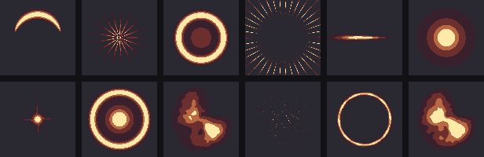
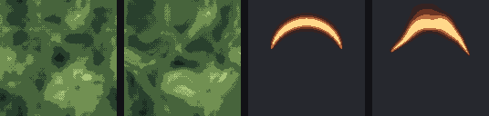
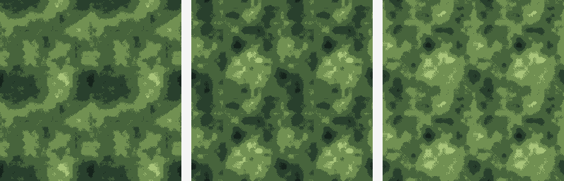
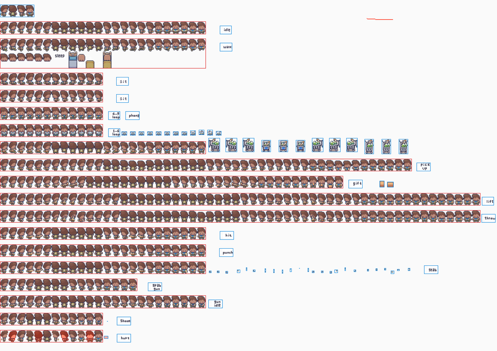
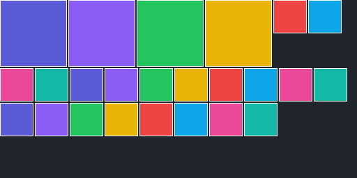
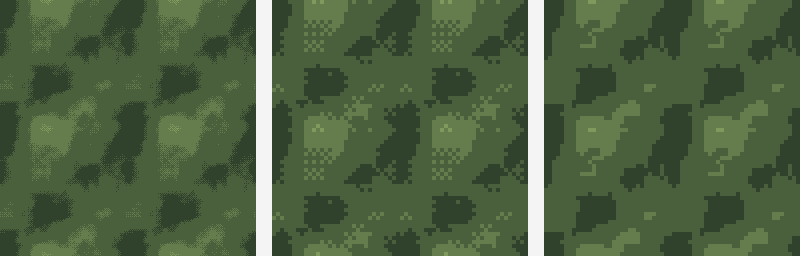
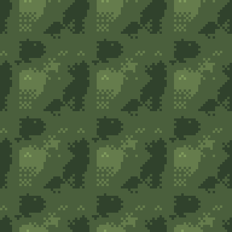

# 迭代记录

## 0.22.0 · 2026-11-09

特效模板从 5 个补到 **12 个**。



| 新增 | 数学 |
| --- | --- |
| 月晕 halo | 宽高斯辉光 + 亮核 |
| 冲击闪光 flash | 中心爆点 + `cos(a·4)^60` 长芒 + 斜向 `^120` 短芒 |
| 能量球 orb | 球体渐变 + 半径 0.72 的轮廓光 + 核心 |
| 星云 nebula | 噪声云（阈值 0.22 拉开对比）× 径向衰减 |
| 微光星场 shimmer | 整数哈希撒点，越靠中心越密 |
| 冲击波 shock | 极薄的锐利环 + 轻微角度扰动 |
| 烟尘 smoke | 噪声 × 径向衰减，**断续交给噪声本身** |

### 两个调参教训

- **烟尘用 `sin(a·6)` 做断续，渲出来是规则花瓣** —— 几何函数天生规整，
  想要「不规则」只能用噪声，不能用三角函数。
- **星云/烟尘第一次几乎全黑**：`pow(cloud, 2.2)` 把中低值压死了。
  正确做法是「先减阈值再归一化」（`(cloud-0.22)/0.78`），而不是调指数。

### 验证

129 项测试全部通过（测试遍历 `FX_PRESETS`，新增的自动被覆盖）。
图是用插件里真实函数渲的，不是示意图。

---

## 0.21.0 · 2026-11-09

「把所有做完」的第一批：调色、整表动画、导出倍率。

### 调色（`选中项`）

色相 / 饱和度 / 亮度三条滑杆 + 应用 / 还原 / 重置参数。

**关键设计：从「调色前的底图」重算**，不是在上一次结果上叠加。
否则拖动滑块会越调越怪，撤销也追不回来 —— `tintBaseRef` 记住每张的原图，还原时直接换回去。

换算走 RGB→HSL→RGB，`shiftPixel` 抽成纯函数（透明像素跳过）。
色相是加角度取模，饱和/亮度是乘法/加法，多个参数叠加时不会互相吃掉。

### 整表动画

选中**一张** 64 整数倍的表，动画预览直接按网格拆帧播放，不必先切图。

实现用的是「裁剪容器 + 负偏移」而不是逐帧 canvas：便宜、不污染画布、也不用异步。
带方向行切换（下/左/右/上）。

### 导出倍率 ×1/×2/×4

按最近邻放大后打包，manifest 里的 w/h 也跟着变成放大后的尺寸。

### 还没做的（明确列出）

- **GIF 导出** —— 需要写 LZW 编码器和调色板量化，是这批里唯一「大」的，单独一轮
- 自定义命名模板
- 切图按帧数均分

### 验证

125 → **129 项**测试：默认参数原样返回、色相 ±360 不变 / 180 出补色、
饱和度 0 变灰、亮度增减方向、结果恒在 0..255。

---

## 0.20.0 · 2026-11-09

**角色配方**。拼半小时的角色刷新就散，是这个工具最痛的一处。

### 做法

- 「存配方」把当前合成列表里的 LPC 部件记成 `{类别, 部件, 动作}`，**不存位置**——
  合成时按锚点重算，存了反而会让不同尺寸的表对不齐。
- 后层（`xxx_bg`）被前层吸收：只记一份，取回时命中 fg 会自动带上 bg。
- 配方列表可「取回」「删」，最多存 50 个，跟棋盘状态一起持久化。
- 取回是**逐件取回来并选中**，合成留给人点 —— 合成读的是渲染后的状态，立刻调用会拿到旧的。

### 三个失误，都值得记

1. **TDZ 又踩了**：`restoreRecipe` 引用后面才定义的 `fetchLpcPart`。这次是移动整块函数解决。
   这是本项目第三次踩同一个坑，说明**放函数的位置**已经成了固定风险点。
2. **用 Node 移动代码块时 `slice(0, -1)` 差点切掉整个文件**：
   `indexOf` 返回 -1 时 `slice(0, -1)` 只砍掉最后一个字符，我当时误判成「文件被截断」，
   差点用 git 覆盖掉未提交的工作。真实情况是文件完好。
3. **PowerShell 的 `git show > file` 写成了 UTF-16**（每个字符带 `\0`），
   读回来全是乱的。以后取 git 内容一律用 Node 的 `execFileSync` + `toString('utf8')`。

### 验证

124 → **125 项**测试：只收 LPC 部件、去重、后层被吸收、空输入返回空数组。

---

## 0.19.0 · 2026-11-09

补四个「每天都在用但一直没做」的基础操作。

### 1. 翻转 / 旋转（`选中项`）

`⇋ 翻转`、`⇅ 翻转`、`↻ 90°`、`↺ 90°`。

**关键是原地换像素**（保留 id / 层级 / 选中），而不是造一张新精灵 —— 造新的会打乱层序，
撤销也变成两步。旋转 90° 宽高互换（`transformedSize` 单独抽出来测，弄反会把图拉变形）。

### 2. 缩放到 ×2 / ÷2、裁透明边

最近邻放大，像素不糊。裁边复用已有的 `trimAlpha`，没边可裁就提示而不是空转。

### 3. 对齐 / 分布

多选 ≥2 出现六向对齐，≥3 再加水平/垂直等距。边界按**选中项的外接框**算，
所以多选和单选的行为是一致的。等距分布两端不动、中间均分。

### 4. 粘贴（Ctrl+V）

**已经存在了** —— 写到一半发现 `importFiles` 早就接好了 paste 监听（截图直接进画布）。
我加的重复监听立刻撤掉。教训：动手前先搜一遍有没有。

### 验证

120 → **124 项**测试：翻转不改尺寸 / 旋转宽高互换 / 六向对齐的坐标 /
单选不产生位移 / 等距分布只动中间且间隙正确 / 少于 3 个不做事。

---

## 0.18.1 · 2026-11-09

「取不到就记下来」。上游 1066 个目录里有一部分是「有目录、没有对应动作文件」，
候选规则只覆盖三种已知形态 —— 与其让用户一次次撞 404，不如把撞到的收集起来。

- 取不到时记 `{类别, 部件, 动作}`，同一条只记一次，上限 200，随棋盘状态一起持久化。
- 素材库底部出现「取不到 N 条」区块：最多显示 40 条 + **复制清单** + 清空。
- 复制格式是 `类别 | 部件 | 动作` 一行一条，粘给我就能照着补规则。

### 验证

119 → **120 项**测试：去重、同部件不同动作算两条、上限 200 且保留最新的。

---

## 0.18.0 · 2026-11-09

用户：「拉取所有素材」。把库从 165 件的精选子集扩到**全量 1066 件 / 19 个类别**。

### 怎么做的（数据没进我的上下文）

1066 条清单不适合贴进对话再粘回代码。做法是让**能联网的那一端直接落盘**：

1. `ego_script` 里 `await import('node:fs')`（Node 的普通 `require` 在 ego 的 ESM 环境里没有），
   递归拉 20 个类别树 → 归成部件清单 → 直接写 `.tmp-lpc.json`。
2. 本地 Node 脚本读 JSON，生成 `LPC_LIBRARY` 字面量并**替换**掉旧块。
3. 只回传每个类别的条数。

全程 1066 条数据没进过对话，`client.js` 从 150KB 涨到 249KB。

### 两次踩空

- **Trees API 用 `type: "tree"`，不是 `"dir"`**（后者是 Contents API）。第一次跑出 0 个类别，
  就是因为过滤条件写成了 `type !== 'dir'`。
- **武器是 `<动作>/<文件>.png` 结构**（动作是文件夹），第一次只识别 `<目录>/<动作>.png`，
  结果武器只抓到 2 件。补了「倒数第二段是动作名」的规则后才到 97 件。

### 新增类别

帽子 140、连衣裙 19、背包 13、工具 9 —— 之前明确放弃的帽子这次也进来了，
并给它们补了 `LPC_DIRS` 与 zPos（帽子 55、连衣裙 30、背包 12、工具 60）。

### 缩略图改成渐进式

163 件的类别一次拉完太重。现在每轮最多 30 张，拉完自动接下一批；
失败标记用 `key in map` 判断（用真值判断会让失败项无限重试）。

### 验证

116 → **119 项**测试：19 个类别 / 总数 ≥1000 / 关键类别下限（武器 ≥90、上衣 ≥150、
头发 ≥110、帽子 ≥130、头 ≥120、盾牌 ≥80）/ 每类第一件都能拼出 URL /
武器 behind 变体用上一级文件名。

---

## 0.17.1 · 2026-11-09

打磨轮 2，外加回答三个疑问。

### 「为什么很多武器只有一行」

不是只有一行，是**尺寸不一样**：

```
weapon/sword/longsword/walk/longsword.png → 576×256   ← 和身体一致
weapon/blunt/mace/walk/mace.png           → 576×256
weapon/sword/katana/walk/katana.png       → 1789×512  ← 大一圈（128 帧）
```

合成用的是**底部居中对齐**，两张不同尺寸的表一叠就整体错位，看起来像武器只出现在某一行。

→ 默认改成 **左上对齐（LPC 标准）**：所有帧共用同一个左上原点，尺寸一致时是零偏移，
不一致时也只有左上对。另加「图层尺寸不一致」警告。

### 「很多没有路径」

武器目录结构不同：`weapon/<组>/<件>/<动作>/<件>.png`（动作是文件夹），
候选里这条排在最后才命中 —— 有点慢但能取到。缩略图失败时会显示占位符，看起来像「没路径」。

### 「除了帽子所有素材都在这吗」

不是，库里是**精选子集**：约 **165 件 / 上游 1000+**。
没做的类别：帽子（140+）、背包、连衣裙、耳饰、箭袋、影子、工具。

### 这轮打磨

1. **顶部快捷入口**：10 个板块一排小按钮，点一下展开并滚过去。
2. **生成快捷键**：面板打开时空格 = 重新生成、R = 换种子（Ctrl/⌘+R 不抢）。
3. **报错停留 2.8s → 7s**（成功 2.2s、普通 3.5s）。
4. **合成尺寸不一致警告**。

---

## 0.17.0 · 2026-11-09

打磨轮 1：素材库从「盲选文字列表」变成能看的东西。

- **缩略图**：取整张表后只裁第一格（64×64），按需拉、3 并发、内存缓存；不做全量预取。
- **跨类别搜索**：搜 `pony` 不再需要先切到「头发」分类；结果带类别前缀。
- 列表从 chips 改成网格（44px 缩略图 + 名称），最高 300px 可滚动。
- 搜索逻辑抽成纯函数 `filterLibrary`，可测。

---

## 0.16.0 · 2026-11-09

用户拿 NoiseGen 的两张截图说「很多功能没实现、很多需要打磨」。

先做了对账，结论是：**NoiseGen 是贴图生成器产品，我们是素材工具**——它一半功能服务于
「做一张无缝纹理」这一个目标。真正该补的里，**域扭曲**排第一：它是唯一会改变所有输出观感的东西。

### 域扭曲（domain warping）

用另一层低频噪声去推采样坐标：直线变弯、圆变有机。参数只有一个强度。

**关键实现细节：采样必须环绕**（坐标取模）。不环绕的话扭曲会在接缝处撕开，
之前辛苦保证的无缝就没了。这条写成了测试。



效果很直观：背景从「规则斑块」变成「流动的形状」；斩击从一条干净的弧变成带能量的抖动弧。

### 放在管线的哪一步

背景：`混合 → 后处理 → **扭曲** → 上色`。
特效：`场 → **扭曲** → 上色`。

放在上色之前，这样扭曲的是强度场，颜色仍然按强度取 —— 不会把色带也搅乱。

### 验证

111 → **113 项**测试：强度 0 是恒等、非 0 改变大部分像素、**扭曲后接缝仍然合格**。

---

## 0.15.0 · 2026-11-09

@B：**程序化特效**。补的是「最难找的素材」——斩击、爆炸、护盾这类一次性效果。

### 思路：特效是**场**，不是贴图

每个特效只是一个 `0..1` 的强度场（归一化坐标、短边为准），然后走和背景同一套上色管线：

- 形状由参数算（弧度、厚度、放射线数…）
- 颜色交给色带 —— **同一套形状换个色带就是白热 / 火焰 / 冰**
- **透明度 = 分级后的强度**：给 `colorizeTexture` 加了 `alpha` 开关，
  外部全透明、核心不透明，这样贴到角色上不会带一块方底

### 五个预设


| 预设 | 数学 |
| --- | --- |
| 弧形斩击 | 沿半径 0.62 的高斯带，角度按 `arcDeg` 截取，两端用 `sin^0.55` 渐细 |
| 爆炸放射 | `cos(a·n)^2.2 × (1-r)^1.6`，n 随强度增加 |
| 光晕圆环 | 环带高斯 + 中心弱发光 |
| 速度线 | `cos(a·n)^14` 的极窄格 + 径向外扩遮罩 |
| 拖尾 | 水平高斯带，宽度随 x 收窄，叠正弦抖动 |

### 为什么不用噪声

背景要的是「随机但无缝」，特效要的是**有明确形状**（一条弧、一个环）。
用噪声做斩击只会得到一团糊 —— 这是两种不同的场函数，不能复用。

### 验证

106 → **111 项**测试：五种特效的值域/非常数/有内容、同种子确定性、
强度单调、弧宽越大覆盖越多、**透明度真的有 0 与满值两侧**。

上图是用插件里**真实函数**渲染的（Node 跑、Python 拼），不是示意图。

---

## 0.14.0 · 2026-11-09

@A：**一键切成帧**。拼完角色到能进引擎，中间还差五六个手动参数，这一步把它抹平。

### 做了什么

「切图」面板顶部加一个按钮：**一键切成帧（64 格 · 四向）**，点一下等于：

1. 网格设为 `64×64`、行列按图尺寸整除（576×256 → 9×4）
2. 开「四向命名」→ `char_up_01` … `char_right_09`
3. 开「跳过空白格」→ LPC 表里动作占不满整行时不会切出空帧
4. **立刻切分**（不必再点一次「切分」）

面板上的参数会同步过去，切完还能接着手调。

### 一处必要的重构

原来 `runSlice` 只会读 state 里的 `previewRects` / `grid`，而 `setState` 是异步的 ——
一键按钮设完参数立刻切，会拿到旧的网格。所以把 `runSlice` 改成接受显式参数：

```js
runSlice(rects, { cols, rows, dirs, skipEmpty, scan })
```

不传就用面板的当前值，老调用点一行没改。`cropFrames` 的「跳过空白格」也一并参数化。

### 验证

104 → **106 项**测试：576×256 按 64 格切成 9×4（含换行与末格坐标）、
四向命名在 9 列布局下的对应关系（第 0 行 up、第 1 行 left…）。

---

## 0.13.3 · 2026-11-09

用户：**第一行（背面）披风位置不对**。

### 查到了权威数据

LPC 生成器自己的 `sheet_definitions/*.json` 里每个部件都写了 `zPos`，直接拉出来：

```
body 10 · legs 20 · feet 27 · torso 40 · arms 60/70
胡子 110/111 · 帽子 115 · 头发 120 · 武器 140/150
双层部件的后层 = 9
```

对照发现：**披风在 LPC 里是压在上衣之上的**，而我把它放在了 `torso(30)` 下面。
结果就是从背面看，披风被盔甲整个盖住 —— 正是我看到的「位置不对」。

### 改法

- 披风从 18 提到 **38**（torso 30、arms 34 之上，head 40 之下），
  这样它盖住盔甲但不会盖住脸。
- 把整张表按 LPC 的**相对顺序**重新对齐并写进注释，标注哪些数字有出处。
  只有披风是刻意上提的（LPC 里披风的 zPos 分散在多个文件，没有单一值）。

### 一个还没敢动的疑点

LPC 表里 **head 125 高于 hair 120**，按升序绘制就是「头盖住头发」——这显然与实物矛盾。
说明 `head` 组里的 zPos 可能同时包含了「脸/眼」这类图层，不能简单当成头型。
我们现在是 hair(50) > head(40)，**实测头发显示正常**，所以这条不动；记下来，以后真遇到
「头发被脸挡住」再回来查。

### 验证

103 → **104 项**测试：披风排在上衣与护臂之后、头之前。

---

## 0.13.2 · 2026-11-09

用户贴了层列表，真相出来了：**只有 `hair_bg 35`，没有 `hair 50`**。

```
 8. lpc_ponytail_bg_walk · hair_bg 35   ← 只有「后脑那截」
 9. lpc_heads/human/male_walk · head 40
```

马尾是双层部件（fg + bg）。**后层本来就压在头下面**，单独存在时必然是看不见的——
所以「头发消失」不是渲染 bug，是**少选了前层**。

### 排查过程复盘

前两轮我猜了两次（替换选择、幽灵层），都不是这张图的原因。真正定位靠的是
**让界面把状态说出来**：层列表加上「部位 + zPos」后，一眼就能看出缺的是哪一层。
这个改造比任何猜测都值。

### 改法：加自检，别再让用户自己看

合成面板现在会检查「有 `xxx_bg` 却没有对应 `xxx`」，有就红字提示：

> 缺少前层：只有 hair_bg，没有对应的 hair。双层部件（马尾、披风、部分盾牌）
> 必须两层都选中，否则只剩被挡住的后层。

这条对披风、盾牌同样适用（它们也有 fg/bg 双层）。

### 验证

102 → **103 项**测试：只有后层时报警、两层都在时不报警、披风同理。

---

## 0.13.1 · 2026-11-09

用户拼出来的角色**又没有头发**。

### 查到的两个真问题

1. **取素材会替换选择，而不是追加。**
   连取「身体 → 头 → 五官 → 头发 → 衣服」，每次取都会把之前的选择清掉，
   于是合成时只剩最后取的那几件。头发就是这么丢的。
   → 改成追加：`setSelection(prev => prev.concat(新增))`，界面上也写清「已加入当前组合」。

2. **解码失败会产生 0×0 的「幽灵层」。**
   `loadImage` 之后没检查 `naturalWidth`，解码失败就是 w=h=0，
   画布上什么都看不见，但层列表里有它 —— 这种最难查。
   → 加断言：宽或高为 0 直接抛错，不进画布。

### 还没定论的

用户这张图里角色是完整的（身体 + 盔甲 + 盾 + 头），说明选择里本来就有多件，
所以「头发没进选择」这个解释不完整。已请用户打开「角色合成」看层列表确认：
**列表里到底有没有 hair 那一层**。有 → 是渲染层的问题；没有 → 是取的时候失败了。

### 验证

102 项测试仍全过（这两处属于交互与容错，现有测试覆盖不到）。

---

## 0.13.0 · 2026-11-09

按「先查结构再写」的方式，**一次性把剩下 8 个类别铺完**。

### 方法（这次没再被 404 教做人）

1. 拿每个类别的目录 sha，**递归拉整棵子树**（不是抽样）。
2. 把每个「含动画文件的目录」归成两种形态：`单层`（`<目录>/<动作>.png`）与
   `fg/bg`（`<目录>/fg|bg/<动作>.png`），只保留能被现有候选规则解开的部件名。
3. 一次写进库，同时把 zPos 定全。

### 新增类别（8 个）

| 类别 | 部件数（库内） | 形态 | zPos |
| --- | --- | --- | --- |
| 胡子 beards | 10 | 单层 | 47 |
| 眼睛 eyes | 8 | 单层 | 46 |
| 鞋 feet | 12 | 单层 | 22 |
| 护臂 arms | 6 | 单层 | 34 |
| 护肩 shoulders | 5 | 单层 | 32 |
| 项链 neck | 11 | 单层 | 44 |
| 披风 cape | 3 | **fg/bg** | fg 18 / bg 8 |
| 盾牌 shield | 8 | 单层 + **fg/bg** | 56 |

### 顺带解决的

- 双层部件的后层不再写死叫 `hair_bg`，改为 `<类别>_bg` —— 披风的后层就是 `cape_bg`，
  排在上衣之下、身体之上。
- 类别从 5 → 13，Seg 排不下，改成可换行的 chips。
- 完整 zPos：`影子5 → 披风后8 → 身体10 → 披风18 → 下装20 → 鞋22 → 上衣30 → 护肩32 →
  护臂34 → 头发后35 → 头40 → 项链44 → 五官45 → 眼睛46 → 胡子47 → 头发50 → 帽子55 →
  盾牌56 → 武器60`。

### 没做的（结构太复杂，明确放弃）

- **帽子 hat**（21852 个文件，且 fg/bg 与体型层级交错）
- **背包 backpack**、**连衣裙 dress**、**耳饰 facial**、**箭袋 quiver**（几乎无动画）
- **影子 shadow** 只有 2 个部件，价值低

### 验证

99 → **102 项**测试：8 个新类别的 URL、披风的 fg/bg 双候选、完整 zPos 顺序。
真机取图仍需用户确认。

---

## 0.12.3 · 2026-11-09

用户点 `ponytail` 报 404。

### 根因：马尾是**两层**

```
hair/ponytail/adult/fg/walk.png   ← 前面那截（压在头之上）
hair/ponytail/adult/bg/walk.png   ← 后面那截（压在头之下）
```

我的候选只有「单层 `<目录>/<动作>.png`」，对马尾这类天然 404。
头发目录里这样的还有 braid、bunches、high_ponytail、long_tied、princess、sara、
shoulderl/r、single、wavy、xlong 等 —— 占了不少。

### 改法

- 候选顺序：**单层 → fg → bg → 动作文件夹**。不是所有头发都分两层，所以单层先试。
- 命中 `fg` 时**自动再取一张 `bg`**，两张都落进画布。
- 新增图层类别 `hair_bg`（zPos 35）：压在上衣之上、头之下 —— 这就是「后脑那截」该在的位置。
  排序表变成 `body 10 → legs 20 → torso 30 → hair_bg 35 → head 40 → face 45 → hair 50 → weapon 60`。
- 顺手清掉了 fetchLpcPart 里重复的路径尝试（现在统一走 `lpcCandidates`）。

### 验证

97 → **99 项**测试：马尾同时给出 fg/bg 两条候选、单层仍排第一、
`hair_bg` 在排序里位于 torso 与 head 之间。

---

## 0.12.2 · 2026-11-09

用户拼出来**头发被头挡住**。

### 根因：层序

合成器按**选择顺序**叠，而用户先选了头发、后选了头 → 头盖在头发上。
LPC 本身有固定的叠放顺序（生成器里每层带 `zPos`），我不能拿选择顺序当叠放顺序。

### 改法

```js
LPC_Z = { body: 10, legs: 20, torso: 30, head: 40, face: 45, hair: 50, weapon: 60 }
```

- **选中变化时默认就按这个顺序排**好，不用用户自己拖。
- 另加「按部位排序」按钮，手动打乱后可以一键复位。
- 稳定排序：都是同类、或都不认识类别的，保持原相对顺序；不认识的排最后。
- 界面上仍然可以上移/下移覆盖 —— 自动只是默认值。

### 验证

95 → **97 项**测试：完整七层的顺序断言（含「头发必须压住头」）、未知类别稳定排最后。

### 这一串的共性

这是第 0.12.1（缺头）之后的连锁问题：**LPC 的每个部件都隐含一个「它在哪一层」的语义**，
而我把它当成了普通的图片叠加。取图时记的 `meta.category` 正好是排层的依据 ——
下次再加类别（盾牌、披风、帽子），第一件事应该是先确定它的 zPos。

---

## 0.12.1 · 2026-11-09

用户拼出来的角色**没有头**（截图里是「头发 + 衣服 + 腿 + 剑」，脖子以上是空的）。

### 根因：LPC 的头是独立类别，还分两层

```
head/heads/human/male/walk.png      ← 头型（光秃秃）
head/faces/male/neutral/walk.png    ← 五官（眼睛/嘴），叠在头上
hair/long/adult/walk.png            ← 头发，再叠
```

身体表 `body/bodies/male/walk.png` **本来就不含头** —— 这是 LPC 的设计，不是 bug。
我之前只加了 body/hair/torso/legs/weapon，把「身体自带脑袋」当成了默认真理。

### 改法

- 新增两个类别：**头**（12 种：human male/female/child/gaunt、orc、goblin、skeleton、
  zombie、wolf、lizard、minotaur、vampire）与 **五官**（9 种表情）。
- 层提示里直接写清楚：**身体不含头，完整角色至少要取五个部位**。
- 测试里钉了一条：库里必须有 `head` 与 `face`，缺了就报「拼出来是无头人」。

### 验证

93 → **95 项**测试（head/face 的 URL 路径、以及「库里必须有头」这条存在性断言）。

### 教训

这已经是同一类错误的第四次：**把某一种输入的默认假设当成全部**
（空状态当全状态、male 当全体型、平铺当唯一结构、身体当自带头）。
前三次是结构，这次是**语义**——比结构更难发现，因为文件都能取到，只是缺了一层。

---

## 0.12.0 · 2026-11-09

素材库补齐 **上衣 / 下装 / 武器**。这次先查结构再写，不猜。

### 查出来的结构（用 GitHub 的 tree API 拉全量，不是抽样）

| 类别 | 文件数 | 部件数 | 层级 |
| --- | --- | --- | --- |
| torso | 11415 | 163 | `torso/<组>/<件>/<体型>/<动作>.png`（三层） |
| legs | 829 | 37 | `legs/<组>/<件>/<体型>/` |
| weapon | 1459 | 99 | `weapon/<组>/<件>/`，另有 `behind` / `universal/background` 变体 |

顺带发现：整仓的 tree 有 5.6 万条就被 GitHub 截断了（停在 `hat/`），
所以必须**按类别拉子树**（用目录 sha），不能拉整仓递归树。这条记下来，以后查大仓用得上。

### 做法

- 部件名允许是**相对路径片段**（`armour/leather/male`），模板 `torso/{item}` 拼出来正好。
  测试相应放宽：不许绝对路径 / `..` / 直接指向 `.png`。
- 「动作/部件名」那种命名里，文件名取**最后一段**（`male`），不是整串路径。
- 挑了常用的一组进库（上衣 15 / 下装 12 / 武器 18），没有把 300 个全塞进面板。
- 按钮上只显示最后两段（`leather/male`），完整路径放 `title`。

### 验证

91 → **93 项**测试：三个新类别的 URL 层级、带路径部件名的叶子取名规则。
真机取图仍需用户确认（我这边 Node 出网被挡）。

---

## 0.11.3 · 2026-11-09

用户反馈：其它体型都行，**只有僵尸失败**。

### 第三种结构

```
body/bodies/male/walk.png             平铺：<目录>/<动作>.png
hair/long/adult/walk.png              多一层 adult
body/bodies/zombie/walk/zombie.png    ← 动作是文件夹，文件名是**部件名**
```

僵尸既不是「平铺」也不是「多一层」，而是「`<动作>/<部件>.png`」。
上一轮我加的候选只覆盖了前两种，所以它 404。

### 改法：不再枚举结构，枚举命名方式

```js
for (每个候选目录) {
  试 <目录>/<动作>.png
  试 <目录>/<动作>/<部件>.png
}
```

两种命名方式 × 若干候选目录，按顺序试。三种结构全被覆盖，以后再来第四种（多半也是变体）
只要落在这两种里就能命中。

### 验证

91 项测试（把僵尸那条结构单独钉了一条断言）。
**这条教训和第 0.11.2 是同一条**：我一直在「看到一种就假设全部」。
现在测试里显式列了三种结构，谁再加类别都得先想清楚属于哪种。

---

## 0.11.2 · 2026-11-09

用户反馈：**`male` 能取到，其它大多失败。**

### 根因：上游各类别的目录层级不统一

实测（不是猜）：

```
body/bodies/male/walk.png        ← 身材：两层
hair/long/adult/walk.png         ← 头发：多一层 adult
```

我把路径规则写死成「类别子路径 + 部件 + 动作」，头发那条必然 404。
**而且我只用 `male` 验证过就把规则推广到全部类别** —— 这是真正的问题：
拿样本验证了，却当成全量验证。

### 改法：候选路径，运行时逐个试

```js
LPC_DIRS = {
  body: ['body/bodies/{item}', 'body/{item}'],
  hair: ['hair/{item}/adult', 'hair/{item}'],
}
```

按顺序 fetch，第一个 200 的用；全失败才报错。上游再加一层、或某类结构不同，都不用改代码。
取回来的图 `meta.source` 记录的是**实际命中的那个 URL**。

### 验证

89 → **91 项**测试：hair 首选带 adult、备用不带、body 不带 adult、未知类别返回空数组。

**仍待真机确认**：body 的其它体型（female / muscular / …）能不能取。它们从列表看和 male 同级
（都在 `body/bodies/` 下），但没有逐个验证 —— 按这轮的教训，**目录结构一致 ≠ 文件齐全**。

---

## 0.11.1 · 2026-11-09 · 修 TDZ 崩溃 + 补「有选中项」的渲染测试

`composeNow` 声明在板块之后 → 一打开面板就 `ReferenceError`。见踩坑 #29。

---

## 0.11.0 · 2026-11-09

@C 第一版：**LPC 素材库**。用户没有素材，所以要能直接用 LPC 的部位。

### 先核实的两个事实（不是猜）

1. `spritesheets/` 下按部位分目录：`body/bodies/<体型>`、`hair/<发型>`、`torso`、`legs`、`weapon`……
2. 每一个 PNG 是**一个动作一张表**：`body/bodies/male/walk.png` 的 IHDR 是 **576×256**，
   即 **9 帧 × 4 向，每帧 64×64**。

第 2 条决定了一件重要的事：**同一动作的各个部位尺寸完全一致**，
所以合成时整表叠加就行，不需要任何对齐逻辑 —— 比单帧合成还简单。

### 做法：只存路径，不存图

- 库里只有 `类别 → 子路径 → 部件名`，没有一张图片。
- 点击时才用 `fetch` 去 `raw.githubusercontent.com` 取原文件。
- 理由（法律）：LPC 是 CC0 / CC-BY-SA / CC-BY / GPL 混合，多数强制署名。
  插件不复制、不分发，只做「按需取回」，所以插件本身不产生再分发行为；
  署名义务回到使用者身上，界面上直接写明。
- 取回来的图带 `meta.source`（原始 URL），便于以后生成 CREDITS。

### v1 范围

- **身体** 8 种体型、**头发** 24 种发型；动作 9 个（walk / slash / thrust / spellcast / shoot / hurt / idle / run / jump）。
- 上游没有的组合（某个发型没有 slash）会 404，界面直接说「上游没有这个组合」，不假装成功。
- torso / legs / weapon 等目录还没核实，留到下一版。

### 验证

86 → **89 项**测试：URL 拼装与上游 `download_url` 逐字一致、未知类别返回 null、
**库里不含任何路径或图片数据**（防止有人往清单里塞素材）。

**没验的**：`fetch` 在浏览器里能不能通。我这个环境的 Node 出网被挡（HTTP 0），
所以只能由你在插件里点一下确认；CORS 上 raw.githubusercontent 是允许跨域的。

---

## 0.10.0 · 2026-11-09

@B 第一版：**角色合成**（单帧）。

### 做了什么

- 选中若干精灵（头/身/腿/武器）→ 它们按选择顺序成为图层，列表里可上移/下移/隐藏。
- 每层可单独调 X/Y 偏移，预览实时更新。
- 合成 → 生成一张新精灵，带 `meta.parts`，走正常的撤销/保存路径。

### 一个必须记下来的设计判断

**「底部对齐」只对「同尺寸整帧图层」成立。**

- LPC 的部件都是 64×64 整帧，角色画在帧内的固定位置 → 直接叠加就对，底部对齐等于没偏移。
- 但紧裁的散件（头 30×24、身 40×36、腿 36×20）如果用底部对齐，三者会**全部压在底边**上，
  互相遮挡，完全不是角色。

所以加了一个 **`stack`（垂直堆叠）模式**：列表末尾在最下面，依次往上排，总高 = 各部分之和。
这才对紧裁散件成立。


上图是用**真实 `composeLayout`** 算位置、Python 拼出来的 —— 左图能明显看到头和身被压在一起。

### 另外两条

- **锚点默认 bottom**：因为主要输入是 LPC 那种整帧部件；散件场景让用户自己切到「垂直堆叠」。
- **顺序不做跨选记忆**：换选择就重置图层顺序与偏移 —— 和之前「预设不跨图沿用」同一个原则。

### 验证

80 → **86 项**测试：底边对齐、中心对齐、左上 + 手动偏移、尺寸取最大、空输入、
**垂直堆叠的总高与逐层 y**、图层排序（未知 id 跳过 / 未列出的补最后）。

### 没做的（v2）

- **多帧 sheet 同步合成**（行走动画）：要处理「部件帧数不一致」，比如头 4 帧、身 10 帧怎么对。
- **从素材库直接拉部件**：等 C 做完。

---

## 0.9.0 · 2026-11-09

补 @2：把背景生成从「单层噪声」补到 NoiseGen 那个完整度。

### 加的东西

| 能力 | 做法 | 为什么需要 |
| --- | --- | --- |
| 第二层噪声 | 独立的 period/octaves/seed，与第一层逐像素混合 | 单层 fBm 铺开能认出同一块；两层不同周期叠上去就压住了 |
| **9 种混合** | 相加/相乘/最大/最小/滤色/覆盖/柔光/差值/相减 | 你要全做 |
| 后处理 | 自动色阶 → 反相 → 对比 → Gamma | 决定「灰不灰、够不够跳」 |
| 多段色带 | 7 套 4 停靠点色带 + 自定义二色 | 二色插值出来的图偏灰；火焰/冰要的是分段色相跳变 |
| 拉伸比 | 1:1 / 2:1 / 4:1 / 1:2 / 1:4（拆成 periodX / periodY） | 横版背景要横向拉长，NoiseGen 也是这个维度 |
| 通道打包 | R=层1 G=层2 B=结果 | 给引擎算法线/遮罩用；肉眼看是花的，别当贴图 |

### 三个实现上的判断

1. **无缝性不会被混合破坏**：混合是逐像素运算，两个周期场混完还是周期的。
   这条写成了测试（`混合后仍然无缝`），四种模式都验过。
2. **后处理顺序写死**：自动色阶 → 反相 → 对比 → Gamma。顺序换了结果完全不同
   （先反相再拉色阶 vs 先拉色阶再反相），所以不做成可调。
3. **柔光用 pegtop 近似** `(1-2b)x² + 2bx`，不是 W3C 那条分段公式。
   差异在 b>0.5 的高光段；像素画场景看不出来，代码少一半。**这条要记，免得以后当成 bug。**

### 验证



- 73 → **80 项**测试：9 种混合的数学、混合后接缝仍合格、后处理各档、色带插值、
  通道打包映射、拉伸比解析与「拉宽后横向变化确实变小」。
- 上图是用插件里**真实函数**渲染的（Node 跑、Python 拼），双层明显更细、重复感更弱。
- 界面上新增的控件（第二层/后处理/通道打包）观感仍需真机确认。

---

## 0.8.3 · 2026-11-09

用户指出：**调研文档里那些功能没适配完，就不算做完基础功能**。对账后发现确实漏了一条
文档自己标了「成本很低、对横版价值很高」的东西 —— **滚动预览**。

### 漏掉的那条

调研 §4（Pixel Water）的结论是：它「每 8 秒精确循环」这个定位，映射到精灵工具的刚需是
**「这段背景是不是无缝、循环起来会不会跳」**，所以值得做的是「选中一张背景条，
按 0.5× 速度横向循环滚动」。我 0.4 只做了生成器面板里的 3×3 平铺预览，
**选中任意一张图来验收**这个入口一直没做。

教训：当时盯着「能生成」，忽略了「能验收」。验收工具比多造十种材质更值。

### 做了什么

- 选中项里加「平铺预览」：`3×3` 与 `滚动` 两个模式。
- 滚动用 CSS `background-position-x` 动画（零 JS 逐帧），速度可调、可暂停。
  一圈时长 = 一个 tile 宽度 / 速度，所以任何尺寸的图都是无缝循环，不会因为
  duration 写死而出现「滚到一半跳回去」。
- 显示尺寸按 300×132 的盒子等比缩放，不放大（放大会糊）。

### 验证

73 项测试全过（纯 UI）。滚动效果只能真机看 —— 关键看两点：
① 一圈结束时有没有跳一下（有跳 = 图本身不无缝或时长算错）；
② 横版背景条在 60 px/s 下看着是否自然。

---

## 0.8.2 · 2026-11-06

用户：**切分框和序号一放大就没了**。

### 根因：把「屏幕恒定」做过头，掉成亚像素

为了让网格线在任何缩放下都一样粗，我写的是 `borderWidth: 1/zoom`、`fontSize: 11/zoom`。
数学上没错（乘上 zoom 又回到 1px / 11px），但**浏览器不画亚像素边框**：

| 缩放 | 世界线宽 | 结果 |
| --- | --- | --- |
| 100% | 1px | 正常 |
| 123% | 0.81px | 还能画 |
| 250% | 0.4px | 开始丢 |
| 400% | 0.25px | 基本消失 |

所以「放大后网格没了」不是没渲染，是**线太细被浏览器丢了**。

### 改法：给世界坐标下的尺寸设下限

```
borderWidth = max(1.4 / zoom, 0.55)
fontSize    = max(11  / zoom, 1.3)
```

两个下限都恰好接在原公式的交叉点上（zoom 2.5 / 8.5），所以过渡是连续的，
不会出现「突然变粗」。代价是放大到 3 倍以上线会略粗（2–3px），但**永远看得见**。

同一类问题顺手修了选中环和四角手柄（`1.5/zoom` 在 4 倍时也是 0.375px）。

### 顺带修的

面板里的结果预览被 flex 压扁成一条（`flex-shrink:1` 默认值）——
加 `flex:0 0 auto` 并在绘制后显式钉住 `style.width/height`。

### 验证

73 项测试全过（这次是纯样式，单测覆盖不到）。缩放行为只能真机确认。

---

## 0.8.1 · 2026-11-06

用户：**扫描行和自动检测要加预览和取消**。之前这两个动作是「点了就生效、没法回头」。

### 做了什么

- **结果预览**：在面板里画一张缩略图（整张图缩到 268×180），把每一帧的框直接描上去。
  一眼看出「整块切得对不对」，不用在画布上找。
- **取消**：`取消扫描` / `取消检测`，清掉结果，画布叠加层和预览一起消失，图片本身不动。

### 为什么预览不用画布上的叠加层

画布那层受 `minCell >= 5` 限制 —— 缩到 50% 以下、或者帧很小的时候它**会被隐藏**，
而这正是「帧很多、需要确认」的时候。面板里的预览不依赖缩放，永远看得见。

### 踩到的坑

切换切分方式时 canvas 是**新建的 DOM 节点**，但 previewKey（矩形串）可能没变，
于是 effect 不重跑 → 新 canvas 是空白。依赖里必须加 `sliceMode`。
（这条也写在代码注释里了。）

### 验证

73 项测试仍全过。画布绘制本身依赖浏览器，只能真机看；
但绘制公式与之前 `scan-result.png` 用的是同一套缩放逻辑（那张图是 Python 按同样公式画的）。

---

## 0.8.0 · 2026-11-06

用户拿来一张手拼的角色表（`Modern_Exteriors_Characters_Scout_48x48_6`），
「怎么切都不对」。先量化，再决定做什么。

### 实测（不是猜）

| 项目 | 数据 |
| --- | --- |
| 尺寸 | 2433×1722，透明率 75.8% |
| 行带 | 20 条，高度 **61 / 63 / 79 / 147** |
| 行内步距 | 42px（同一行连续 12 次），但首段 **504px 连续粘连** |
| 2433 ÷ 48 | 50.7 —— **不是整数，图被缩放过** |
| 图里还烧着 | `sleep` `Sit` `1-6 loop` `PICK UP` 等标注文字 |

结论：这不是网格表。网格的前提（等距）不成立，所以「怎么调参数都不对」是必然的。

### 做了什么：按行扫描

新增第三种切分方式。分两步：

1. **切行带**：按行投影，小于 `rowGap` 的空隙算同一行 —— 行高不一是允许的。
2. **行内切帧**：在每一行内部做列投影。

并且补了一个「**每行指定帧数 → 等分**」的入口：行内字符物理上贴着时，
「这一行有几帧」是人一眼看得出、机器猜不准的信息，交给用户填比任何算法都准。

### 诚实记录：行内粘连没解决



- 19 条行带全部切对（位置与视觉结构完全一致）。
- **但 18/19 行里角色是焊成一条的**：提高 alpha 阈值（12→250）无效，
  改用「列内容密度」阈值（0→0.25）也只能在「粘连」和「把角色劈碎」之间摇摆。
  原因是这张图的字符在物理上真的贴着 —— 没有算法能凭空分开。
- 所以最终路径是：扫描出行 → **逐行填帧数** → 等分。20 个数字，比逐个拖框现实得多。

### 验证

- 70 → **73 项**测试：行带切分、细缝容差、行高不一、minRowH 过滤、空图、
  等分铺满/不重叠/不留缝、等分范围不含右侧标注、退化输入。
- 真实数据验过两轮：`scanRows` 在原图上的 19 行输出与目视完全吻合（上图）；
  参数扫描证明没有一档能自动分开粘连（这条也写进了本文档，免得以后重复试）。

---

## 0.7.0 · 2026-11-06

路线最后一项（可交付的那部分）：**动画预览**。补的是「切完不知道帧序对不对」。

### 做了什么

- 选中 ≥2 张图 → **按名字自然序排队**（`hero_2` 排在 `hero_10` 前面），自动成为播放序列。
- 播放/暂停、8 / 12 / 24 fps、**洋葱皮**（半透明上一帧）、帧条点选跳帧。
- 预览盒里所有帧按**底部居中**叠放 —— 这是动画的脚底基准；帧尺寸不一致（裁透明边之后常见）
  也能看出对齐对不对。
- 切换选择时自动停播并回到第 0 帧。

### 为什么排序要单独写

字符串比较会把 `hero_10` 排在 `hero_2` 前面（1 < 2 在第一位就分胜负）。
切图产物全是 `_01…_10` 这种名字，直接 `.sort()` 必然错序。
所以写了 `compareNatural`：把名字切成「数字段 / 非数字段」，数字按值比、其它按字面比。

### 验证

- 61 → **65 项**测试：`hero_2 < hero_10`、方向名混排、两位补零的真实命名、
  `sortFramesByName` 不改原数组且不丢帧。
- 播放本身（定时器、洋葱皮叠放）没有单测覆盖 —— 依赖浏览器渲染，只能真机看。

---

## 0.6.1 · 2026-11-06

用户：**选中的图块太不明显了**。

### 根因（两条，第一条更致命）

1. **描边宽度是写死的 1.5px，而它在被 scale(zoom) 缩放的世界层里** ——
   zoom 缩到 0.3，屏幕上只剩 0.45px，等于没有。这跟当初切分网格线被压住是同一类错误：
   忘了世界坐标和屏幕坐标是两套。
2. 单色描边在彩色图上对比不足，在白底上又糊。

### 改法

- **双色环**：白内圈 + 品牌色外圈。白色在深色图上显眼，品牌色在白底上显眼，两头都占。
- **四角手柄**：主选中项画四个小方块，多选时只画主项，不然糊成一片。
- **线宽按缩放补偿**：`1.5/zoom`、`3.5/zoom`、手柄 `6/zoom` —— 任何缩放下都是固定屏幕像素。
- 图在屏幕上小于 14px 时不画手柄（四个方块会把图糊住）。

### 一个刻意的取舍

**没有抬选中项的 z-index**。抬了确实能让环盖住压着它的图，但切分预览层是 `max(z)+10` ——
抬完就反过来被选中项盖住，等于把之前的 bug 又请回来。环被别的图压住就压住，不牺牲网格预览。

### 验证

61 项测试仍全过（这次改的是渲染样式，单测覆盖不到）。
**视觉效果只能真机看** —— 麻烦你缩放几下试试，特别是缩小到 50% 以下时环是否还清楚。

---

## 0.6.0 · 2026-11-06

路线第 3 项：**图集打包 + pivot 元数据**。补的是「只能一张张导出、引擎里还得手算坐标和锚点」这个短板。

### 做了什么

- `packRects`：货架式装箱（按高度降序，一行行铺）。输出 `{width, height, placed}`，
  尺寸上限 1024/2048/4096 可选，间距可调，可补到 2 的幂。
- `buildAtlasJson`：元数据字段**照抄 Aseprite**（`frame` / `spriteSourceSize` / `sourceSize` / `pivot`），
  不是自己发明一套 —— 引擎侧普遍直接能认。
- **锚点可选**：中心 / 脚底居中 / 左上角。选「脚底居中」把 `pivot: {x:0.5, y:1}` 写进 JSON，
  角色才能直接踩地；没有 pivot 的图集，引擎里还得自己算。
- 输出走已有 ZIP 通道：`atlas.zip` 内含 `atlas.png` + `atlas.json`。

### 两个实现取舍

- **没引 `maxrects-packer`**：客户端模块拿不到 npm 依赖（模块加载器只给 React）。
  MaxRects 要维护空闲矩形列表，代码量翻倍，而图集面积通常只差几个百分点；
  输入又多半是一批同尺寸帧，货架已经接近最优。手写 40 行，零依赖。
- **补 2 的幂会浪费面积**：实测 24 张（4 张 96² + 20 张 48²）在 2048 上限下排成 512×256，
  利用率 0.633 —— 高度其实只用 ~180，补齐到 256 白扔了四分之一。所以「补齐 2 的幂」是开关，
  不是默认真理；不吃 2 次幂的引擎可以直接关掉。

### 验证



- 55 → **61 项**测试：不重叠 / 不越界 / 数量不丢 / 尺寸忠实输入 / pot 输出为 2 的幂 /
  超大单张返回 null（不静默截断）/ 空输入 / 元数据字段与 pivot / `nextPow2` 边界。
- 上图是用 client.js 里**真实的 `packRects`** 算出的布局（Node 跑函数、Python 画方块），
  目视确认无重叠、间距均匀。
- 界面观感与「下载的 ZIP 能不能被引擎吃」仍需用户确认 —— 后者取决于他用哪个引擎。

---

## 0.5.2 · 2026-11-06

用户发现一个真 bug：**A→B→取消 B 之后，参数回到了 A，但 A 不亮**。

### 根因

我把「应用预设前的状态」只存成了**一份网格**，没存「当时哪个预设亮着」。
于是取消 B 时还原了 A 的参数，却把 `activePreset` 设成了 `null` ——
参数说「这是 A」，界面说「没有预设」。两者对不上，用户的感受就是「坏了」。

### 改法：单份快照 → 栈

每层压入 `{ grid, preset }`，取消时**连「当前生效的预设」一起还原**：

```
点 A：压 {网格默认, 预设 null}  → 应用 A
点 B：压 {网格A,   预设 A}       → 应用 B
取消 B：弹出 {网格A, 预设 A}     → 网格回 A，A 重新亮起
取消 A：弹出 {网格默认, 预设 null} → 回默认，无高亮
```

栈上限 20 层（防止长会话里无限涨）。手改参数 / 换图 / 按内容推断仍会清空整个栈 ——
链断了就不该还能往回撤。

### 验证

- 53 → **55 项**测试：栈序还原（连 preset 一起）、空栈返回 null、超限丢最老的。
- 这个 bug 只有在「连续点两个预设再取消」时才会出现，单测覆盖不到 UI 层，
  所以专门把栈的两个操作抽成 `pushPreset` / `popPreset` 纯函数来钉住不变量。

---

## 0.5.1 · 2026-11-06

用户要求：预设按钮要能看出「当前选的是哪个」，再点一下取消。

### 做了什么

- 预设按钮加**选中态**（`data-active`，边框与底色高亮），hover 提示会写「再点一下取消」。
- **再点同一个 = 取消**，并且把网格**恢复成点预设之前的样子**（应用时存了一份快照）。
  只清高亮不还原数值，等于「点了没反应」—— 那不叫取消。
- 手改任何网格参数 / 换一张图 / 按内容重新推断，都会**自动清掉预设标记**：
  那套参数已经不成立了，还高亮着就是撒谎。

### 验证

- 52 → **53 项**测试：`presetToggle(active, kind, id)` 四种情形
  （同一个→取消、换一个→应用、不同类目同名 id 不算、没有生效预设→应用）。
- 说明：按钮高亮的**渲染**没法用垫片验（组件树测试时没有选中图，切图分支不渲染），
  这一层只能靠真机看。

---

## 0.5.0 · 2026-11-06

路线第 2 项：**网格预设**。目标是把「数格子」这件事彻底消掉。

### 做了什么

- **单元格尺寸预设**（4 个）：LPC 64 / 图集 32 / Kenney 18 / Kenney 16。
  点一下按图片尺寸整除出行列，外边距与间隔归零。
- **LPC 动作预设**（4 个）：突刺 / 行走 / 挥砍 / 坐下。
  一次设好「4 行 + 行号偏移」，直接切出某个动作的四向表。
- **四向命名**：勾上后按 `hero_up_01`、`hero_left_01`… 命名，而不是一串无意义的序号。
- **跳过全空白格**：LPC 通用表宽 13 列，但「行走」只占 9 列 —— 剩下 4 列全透明，
  以前会生成 4×N 个空帧。现在整格全透明就跳过，帧数正好等于该动作的真实帧数。

### 关键：数值是查出来的，不是猜的

行号与方向顺序来自生成器源码 `sources/custom-animations.ts`：

- `animationRowsLayout`：thrust 3–6、walk 7–10、slash 11–14、sit 29–32
- 每个动作的 `frames` 数组都是 4 行，顺序 **n / w / s / e**（上、左、下、右）

所以 `LPC_DIRECTIONS = ['up','left','down','right']` 是有出处的，不是按习惯排的。
同时界面上所有数值仍然可改 —— **这张表会随生成器版本变化**，不能当恒定事实。

### 许可上的取舍

预设**只存参数、不带任何素材**：LPC 那批图是 CC-BY-SA + GPL 混合，
打包分发会把插件拖进传染义务；只存「64×64、第 7 行起」这种事实，没有版权问题。
用户自己去生成器下载图，署名责任在他那边。

### 验证

- 47 → **52 项**测试：预设数值合理性、行号与方向顺序、四向命名的列/行换算、
  非 4 行时回退序号、索引越界不炸。
- 手算核对：832×1408 的 LPC 表（13×22 格）套「行走」→ cols=13、rows=4、padY=448，
  筛掉空白后正好 36 帧（9 帧 × 4 向），命名为 `hero_up_01…hero_right_09`。
- 界面观感仍需用户确认。

---

## 0.4.3 · 2026-11-06

用户明确表态：**网格不要记住**。

顺手修掉一个我原本没意识到的「变相记住」：`grid` 是组件状态，切完 4×4 的 sheet 再选一张单图，
它还是 4×4 —— 等于跨图沿用了参数。

### 改法

- 换选一张图（`sliceTargetId` 变化）时，网格重置回默认 1×1、清零外边距/间隔、
  清掉「已推断」标记，然后由该图重新推断。
- `gridGuessRef` 从「已推断过的 id 集合」改成 **每张图各自的推断结果缓存**（`id → {cols,rows}|null`）。
  这缓存的是「这张图长什么样」，不是「上次用了什么参数」—— 换图不会带参数过去，
  但同一张图来回切换不会重复扫像素。
- 手动改过参数后，仍以用户为准（`gridTouchedRef`）。

### 验证

47 项测试仍全过。行为变化只有一处：换图时网格会重置并重新推断。

---

## 0.4.2 · 2026-11-06

用户截图报：切图一进来就是 `列 1 / 行 1` —— 切出来就是整张，等于没切。

### 根因

默认值写死成 1×1。对「单张精灵」这是对的（一整张 = 一片），
但对「sheet」就是废的默认值，而用户十次里有九次切的是 sheet。

### 改法：按**内容**推断，不是按尺寸

打开「切图」且网格仍是默认 1×1 时，自动跑一次 alpha 连通域，取所有块的中位宽高，
再除图片尺寸得到行列：

```
连通域边界 → 中位宽高 → cols = round(图宽 / 中位宽), rows = round(图高 / 中位高)
```

- **为什么不按图片尺寸猜**：128×128 既可能是 2×2 的 sheet，也可能是一张单图 ——
  尺寸整除关系对两者都成立，纯尺寸推断必然误判。内容才是信号。
- 只推断一次/张（`gridGuessedRef` 记账），单图推断不出来就保持 1×1，不打扰。
- **一旦手动改过任何网格参数**（`gridTouchedRef`）就再也不自动改 —— 用户的选择优先。
- 另外给一个「按内容推断」按钮，随时可以重算；推断失败会明说原因（单图 / 背景不透明）。

### 验证

- 42 → **47 项**测试（新增 4 块→4×4、单块不推断、碎块不推断、非方形排布、median 奇偶）。
- 界面观感仍需用户确认。

---

## 0.4.1 · 2026-11-06

用户看第一版背景图说：「散落的像素有点不对劲，像素素材基本是连续的」。对的，这是个真缺陷。

### 根因（三条，第 1 条是主因）

1. **全局 Bayer 抖动**：逐像素比较阈值，于是中间调被摊成**满屏棋盘格**。
   真实像素画只在两条色阶交界附近抖动，其余地方是硬边。
2. **细节层把最细晶格推到接近逐像素**：128 图 + `period=3` + 6 层 → 最细晶格 96 格，
   差不多每个像素独立取值。
3. **根本原因：缺「逻辑像素」概念**。像素画是在 32×32 上画的、放大 4 倍给人看；
   我却在 128×128 上逐像素决策，自然碎。

### 改法

- 新增 **`cell` 像素块**（1× / 2× / 4× / 8×，默认 4×）：先在 `w/cell` 的逻辑网格上算，
  再最近邻放大。每个决策变成一个 4×4 的块，边界才连续。
- **抖动改成带状**：只在 `frac` 落在 0.5±0.16 的窄带里用 Bayer，其余按阈值硬切。
  常量 `DITHER_BAND` 写在 `colorizeTexture` 上方。
- 默认细节层数 6 → 5。

### 验证



- 42 项单测仍全过。
- **诚实记录**：对比图里左块（`cell=1`、旧参数）也变得连续了 —— 说明「散落」的**主因是全局抖动**，
  不是层数。层数只影响细节密度，不影响成块感。原假设里把两者并列是错的。
- 新默认输出的平铺图：[bg-generated.png](assets/bg-generated.png)。

---

## 0.4.0 · 2026-11-06

第一件按调研路线落地的事：**无缝背景生成**。补的是「插件造不出背景」这个最大缺口，
横版视差层和俯视地表都吃这个能力。

### 做了什么

- 新增「生成背景」板块（右侧第 4 个），参数：尺寸（16²/32²/64²/128²/256²/512×256 条）、
  5 套配色预设 + 自定义深浅两色、起伏（晶格密度）、细节层数（octaves）、色阶、Bayer 抖动、种子。
- 参数一动就重算缩略图（130ms 去抖），预览用的是 **CSS `background-repeat` 真平铺**——
  预览里看到的就是平铺后的样子，不用脑补。
- 「生成并放入画布」走正常精灵流程：自动命名 `bg_横x高_种子`、落位在内容下方、可撤销。

### 算法（关键就一句）

**噪声晶格索引对周期取模**（`i % p`），于是 x=0 与 x=W 采样到同一格，左右/上下天然接得上。
不是后期接边、不是镜像拼接，是采样时就把坐标卷回去了。

- `periodicFbm`：周期值噪声 + 双线性 + smoothstep + 多层叠加（amplitude 0.5^k）。
  层数会被「晶格已经比图还密」截断，再叠只是逐像素噪点。
- `colorizeTexture`：值 → N 级色阶（像素画要的是色阶不是渐变），可选 4×4 Bayer 有序抖动
  把两档之间摊成棋盘纹。
- `mulberry32` 做种子 PRNG：同种子必定同图。

### 验证

| 项目 | 结果 |
| --- | --- |
| 单测 | 36 → **42 项**（Bayer 排列、值域、同种子同图、**接缝梯度 vs 内部梯度**、上色、抖动） |
| 真实输出 | 用 client.js 里的函数直接生成 128×128，平铺 3×3 落成 PNG |
| **接缝数值** | 左右 `9.29` vs 内部 `12.27`（**0.76×**）、上下 `12.71` vs `12.25`（**1.04×**）—— 接缝处与内部统计上无差别，这就是「无缝」的客观定义 |



### 已知取舍

- 只用单层噪声。要压住「看得出是同一块在重复」，下一步可以叠第二层不同周期的噪声
  （调研里 NoiseGen 的双图层混合就是这个思路）。
- 只有噪点一种材质。砖墙/木纹/水波这些需要不同的基底函数，不在这一版。
- 平铺预览只在生成面板里；「把画布上任意一张图按平铺预览」还没做（小功能，后面补）。

---

## 0.3.2 · 2026-11-05

用户报：拖动图块时切分网格不跟着走；顺便重做图标、改名「切片牢大」。

- **网格跟随**：拖拽为了 60fps 是直接写 `el.style.left/top`（不 setState），
  而预览层是同一 world 里的**兄弟节点**（它得压在所有精灵之上，所以不能做成 sheet 的子节点）。
  结果：图动了，网格留在原地，`pointerup` 后才跳过去。
  改法：手势循环里同步挪预览层，逻辑抽成纯函数 `overlayDragPosition(moving, ownerId, dx, dy)`——
  拖的不是 sheet 就返回 `null`，不动它。
- **图标**：原来是「三个白方块 + 一个带加号的偏移块」，看不出和切片的关系。
  改成 **三个实心格 + 一个虚线格**（2×2 里空着待切的那格），一眼是「一张 sheet 被切成格」。
- **顶栏品牌标**：原来只是个纯色渐变方块，现在复用同一套图形（`BrandMark` 组件），
  侧栏图标与面板标题视觉统一。
- **改名**：显示名「精灵工坊」→「切片牢大」。包名 `dsh-sprite-studio` 不变（npm 包名不能中文），
  面板 id 也不变（改了等于换一个插件，历史数据接不上）。

验证：`node --check` 通过；35 → 36 项测试全过（新增拖拽跟随的坐标计算）。
图标 SVG 重新解析校验过（`viewBox 0 0 64 64`，969 字节）。

---

## 0.3.1 · 2026-11-05

用户指定按键：复制改 `Ctrl/⌘+C`、左键选图拖动、中键移动画布。

- **复制**：`Ctrl/⌘+D` 解绑，改为 `Ctrl/⌘+C`（复制一份并偏移 24px，不是写系统剪贴板）。
  顺手把「复制」按钮加 tooltip 标注快捷键。
- **中键平移**：`boardPointerMode(button, onEmpty)` 决定意图 —— 中键在任意位置都平移
  （压在精灵上也行：`startItemDrag` 对非左键直接 return 且不 stopPropagation，
  事件冒泡到画布）；左键在空白处仍然平移并取消选择。**保留了左键拖空白平移**，
  没有因为引入中键而拿走旧手势。
- **键盘重构**：原来 `onKey` 是一串 if，加键就要重复抄 `preventDefault`；
  现在拆成纯函数 `resolveShortcut(e) → 'undo' | 'duplicate' | …`，`onKey` 只做 dispatch。
  好处很直接：可以在 Node 里断言「Ctrl+D 已解绑」这种回归，不用开浏览器。
- **中键的坑**：Chromium 给中键绑了「自动滚动」，是 `mousedown` 的默认动作，
  所以除了 `pointerdown` 接管，还要在 `mousedown` 里对 `button === 1` preventDefault。

验证：`node --check` 通过；30 → 35 项测试全过（快捷键 4 项 + 鼠标映射 1 项）。
界面手感仍需用户确认。

---

## 0.3.0 · 2026-11-05

用户反馈三条（导入修好之后）：

### 1. 选中图片时右侧板块别自动展开

- 折叠状态原来住在 `Section` 内部（`useState(initialOpen)`），默认值是「展开」。
  面板一卸载（切到别的面板再回来）状态就没了，于是每次进来都是全开。
- 改成**受控**：状态提到面板，五个板块默认全 `false`，并随 `view` 一起存进 IndexedDB
  （`kv.board.sections`），开过哪几个会被记住。
- 收起时 `aside` 给一行摘要，不至于一眼什么都没有：选中项显示尺寸、切图显示「N 张」、
  导出显示「N 张」、画布显示「N 个」。

### 2. 「置顶」看不懂

- 它其实是**图层顺序**（`z`）：把它叠到所有精灵的最上层，只有重叠时才看得出效果。
  一个字的词承担不了这个语义，改名为「移到最前」并加了 tooltip。
- 没有改行为 —— 这个功能本身是需要的，只是名字不合格。

### 3. 导出

- 原来的「逐张下载」会让浏览器弹「是否允许下载多个文件」，很多情况下只放行第一个。
  现在主路径是**一次打包 ZIP**：每张一个 PNG（原名，重名自动 `-2`）+ `manifest.json`
  （尺寸、画布坐标、缩放）。
- ZIP 自己写（store 模式 + CRC32，约 100 行），不引依赖：PNG 已经压过，再 deflate
  收益很低。
- 新增右侧「导出」板块：范围（选中/全部）、打包 ZIP、逐张下载、导出/导入工程。
  工具栏的「导出」= 用当前选择打包。

### 验证

| 项目 | 结果 |
| --- | --- |
| JS 语法 | `node --check` 通过 |
| 测试 | 25 → 30 项（新增 ZIP 结构 4 项 + 板块收起 1 项） |
| **ZIP 真机验证** | 用系统的 `Expand-Archive` 解开自己生成的 ZIP：4 个文件都在、大小对、PNG 魔数 `89 50 4E 47` 完好、中文名 `剑士.png` 正常、`manifest.json` 可被 `ConvertFrom-Json` 解析 |
| 界面观感 | 仍需用户确认（Web 端要 token，Agent 不取） |

### 为什么 ZIP 的验证要借外部解压器

自己写压缩又自己写解压，等于用一个实现证明它自己。标准解压器能过，才说明字节结构
（local header / central directory / EOCD / UTF-8 标志位）真的对。

---

## 0.2.1 · 2026-11-05

用户报：「只能拖入，导入图片没有作用」。

**根因**：`const files = e.target.files; e.target.value = '';` —— `input.files` 是**活**的
FileList，清空 `value` 会把之前的引用一起清空，所以 `files.length` 永远是 0。
拖入走 `dataTransfer.files`，不经 `value` 重置，所以一直正常。

**为什么只有一条路径坏**：这正是定位线索 —— 两条入口一条好一条坏，差异点必然在两者不同的
那一步（这里是「清空输入的时机」），而不是共用的导入逻辑。

**改法**：
- `takeInputFiles(input)`：`Array.from(input.files)` 先快照，再 `value = ''`。
- `importFiles` 的过滤加后缀兜底（有些系统不给 `File.type`）。
- 隐藏文件输入从 `display:none` 改成视觉隐藏（1px/opacity 0/移出视口）。
- 回归测试 +2（含一条用 getter/setter 模拟活 FileList，顺序写错就会失败）。

**验证**：`node --check` 通过；25 项测试全过。真机点击仍需用户确认 —— 这一条只有
「点一下按钮、选完文件、图出现在画布上」能算验证通过。

---

## 0.2.0 · 2026-11-05

用户三条反馈，逐条改。

### 1. 撤销 / 重做

- 快照式，60 步上限。一条历史 = `{sprites, selection}` 的数组引用：图片是 dataURL
  字符串，未改动的条目两条快照共享同一个对象，所以不是像素深拷贝。
- 覆盖：导入、拖动、改名、缩放、不透明度、像素锐利、删除、复制、置顶、切分、
  抠图、一键处理、导入工程、清空。
- 连续输入合并：`name:<id>` / `scale:<id>` 在 700ms 内复用上一条。
- `Ctrl+Z` / `Ctrl+Shift+Z` / `Ctrl+Y`；工具栏两个图标按钮，`disabled` 跟随栈深，
  title 里带「还剩几步」。
- 撤销后要同步 IndexedDB：`planRestoreDiff(prev, next)` 算出「哪些要删、哪些要写回」。
  撤销一次新增 → 那些 id 进删除队列；撤销一次删除 → 它们重新变脏写回。
- **镜头不进历史**：`view` 只持久化。撤销后不 `fitTo`，否则每按一次视角就跳。
- 清空画布改成可撤销（原来直接清库，现在只是标记删除）。

### 2. 措辞去「帧」

切出来的是「张 / 小图 / 切片」，不预设为动画帧。改了按钮文案、计数、提示、
测试名和文档；内部 `kind: 'frame'` 也改成 `'slice'`。
唯一保留 `frame` 的地方是图集格式的字段名（那是行业标准字段，不是我们的措辞）。

### 3. 切分网格预览

- **根因**：预览层 `.ss-slice` 没写 `z-index`（`auto`），精灵的 `zIndex` 是 1..n，
  层叠上下文里有正 z-index 的定位元素永远在上面 → 网格线被图片盖住。
- 修法：`zIndex = max(z) + 10` 动态算（置顶会把 z 推高，写死会被追上）。
- 顺手增强：格线恒为 1 屏幕像素（`borderWidth = 1/zoom`）、格子够大时左上角标序号、
  面板里加读数 `网格 4×4 = 16 张 · 单格 32×32 px`。

### 验证

| 项目 | 结果 |
| --- | --- |
| JS 语法 | `node --check` 通过 |
| 测试 | 17 → 23 项全过（新增 4 项撤销差异 + 2 项预览层） |
| 重装 | `install_bundle` → `applied` |
| 槽位 | `sidebar.panellist` / `main` 均 active |
| 界面观感 | 仍需用户确认（Web 端要 token，Agent 不取） |

### 已知遗留

- 历史只在内存：刷新后从零算起。
- 撤销不还原镜头（设计决定，见踩坑 #17）。

---

## 0.1.0 · 2026-11-05

第一版。从零建包，一次装成功。

### 做了什么

- 项目骨架：`package.json`（`dsh.bundle.patch` + `dsh.client.platform: web`）、
  `cordis.patch.yml`（插入 `sprite-studio` 行）、`index.js`（空 `apply`）、
  `locale/zh.json` + `locale/en.json`（插件市场显示标题/描述）、`icon.svg`。
- `client.js`：单文件、无构建、`window.__ModuleLoader__.load` 形态。
  - 注册 `sidebar.panellist`（id `sprite-studio`, order 50）与 `main`（key `sprite-studio`）。
  - `StudioPanel`：顶栏 + 画布 + 右侧检查器（选中项 / 切图 / 抠图 / 画布 四个分区）。
  - 纯函数算法：`gridRects`、`autoRects`、`applyMatte`、`dominantBorderColor`、`trimAlpha`。
  - 持久化：IndexedDB，脏标记增量写 + 550ms 去抖。
  - 导出了 `__test`（纯函数 + 组件引用）给 Node 侧测试用。
- 测试：`tests/smoke.mjs`，17 项全过。

### 验证到什么程度

| 项目 | 结果 | 证据 |
| --- | --- | --- |
| JS 语法 | 通过 | `node --check client.js` / `index.js` |
| 清单与 locale | 通过 | JSON 解析；`package.json` exports 齐全 |
| 图标 | 通过 | SVG 解析成功，根 `viewBox="0 0 64 64"`，936 字节 |
| 安装 | `application: applied`，无 warnings | `plugin_manager install_bundle` |
| 侧栏槽位 | `sprite-studio` 出现在 `sidebar.panellist.occupants`，`active: true`, order 50 | `cordis_inspect_query` Slots |
| 主面板槽位 | `main` 出现 key `sprite-studio`，`active: true` | 同上 |
| 切分/抠图算法 | 17 项断言全过（含「内部同色块不被漫水」「软边半透明」「邻近合并」「统一尺寸」） | `node tests/smoke.mjs` |
| 组件树首渲染 | 不崩溃，结构完整（`ss-app` / 画布 / 检查器 / 空状态 / 四个分区） | 同上，最小 React 垫片遍历 |
| **界面观感 / 真机交互** | **未由 Agent 验证** | DSH Web 要 `dsh web` 打印的带 token 地址才能进页面；按规则不去翻 token。**需要用户点开看一眼。** |

### 安装细节

`install_bundle` 把它作为 `link:` 依赖装进 profile：

```
+ dsh-sprite-studio 0.1.0 <- D:\_Projects\dsh-sprite-studio
```

也就是说改源码即时生效在磁盘上，但**浏览器里已加载的模块不会自动换**：
改完 client.js 要刷新窗口（`Ctrl+R`）才看得到。

### 待办

- 用户侧确认界面后，按反馈修视觉细节（间距、暗色主题对比度）。
- 0.2 候选见 [开发计划.md](开发计划.md)。
